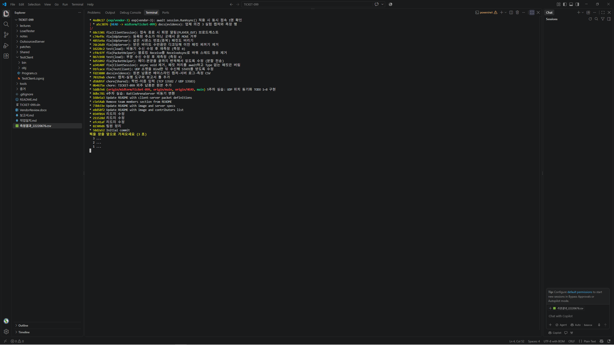

# TICKET-099 외주 납품본 인수 검토 보고서

| 항목 | 내용 |
|---|---|
| 학번 / 이름 | 22220676 / 이지호 |
| 포트 | TCP 13582 · UDP 13583 (10000 + (22220676 % 1999) × 2 = 13582) |
| 측정 PC | Microsoft Windows NT 10.0.19045.0 · 논리 코어 12개 · .NET 8.0.33 (SDK 8.0.427) — LoadTester 8번, `증거/B0_info_pcinfo_1027_234635.png` |
| 저장소 | https://github.com/Ulsan-Rock/GameNetwork · 브랜치 `midterm/ticket-099` (실험 `exp/vendor-3`) |
| 검토 대상 | OutsourcedServer v0.9, TestClient v0.9 |
| 제출일 | 2026-10-28 |

---

## 0. 결론

**인수 판정 : 반려**

1. 형식이 깨진 패킷 하나(LT 4), 또는 두 번에 나뉘어 도착한 패킷 하나(LT 2)로 **서버 프로세스 전체가 꺼진다.**
2. 동시 접속이 코어 수(12)를 넘으면 로그인이 무너진다. 원본은 **50명 중 31명, 500명 중 456명이 실패**했다 (CSV 2026-10-27 23:49 행).
3. UDP 위치 처리에서 **남의 ID로 위치를 바꿀 수 있고**, 중복 패킷을 버리지 않으며, 이전 패킷 찌꺼기 때문에 좌표가 틀어진다.

업체 검토서의 "치명적 결함 0건, 부하 테스트는 불필요"는 실제로 돌려 보니 사실이 아니었다. 아래 8건을 고친 뒤 같은 시나리오로 다시 돌려 모두 기대대로 동작함을 확인했다.

| ID | 증상 | 파일 (원본 줄) | 재현 | 수정 커밋 |
|---|---|---|---|---|
| A1 | 패킷이 나뉘어 오면 서버가 죽는다 | PacketHelper.cs L51, L63 | LT 2 | `bd51092` |
| A2 | 동시 접속이 코어 수를 넘으면 로그인이 막힌다 | PacketHelper.cs L51, L63 | LT 1 | `cf4c97f` |
| A3 | 형식이 깨진 패킷 하나로 서버 전체가 꺼진다 | ClientSession.cs L50, L68, L73 | LT 4 | `a34140f` |
| A4 | 위치 뒤에 이전 패킷 찌꺼기가 붙어 좌표가 틀어진다 | UdpServer.cs L80 | LT 6 | `7dc26d9` |
| A5 | 같은 번호(중복) 위치 패킷을 버리지 않는다 | UdpServer.cs L129 | LT 5 | `4855e9a` |
| A6 | 남의 PlayerId로 보내면 그 사람 위치가 바뀐다 | UdpServer.cs L115–124 | LT 7 | `c74ef9c` |
| A7 | 테스트 클라이언트가 다른 사람 위치를 못 받는다 | TestClient/Program.cs L149–161 | TestClient 2개 | `91fcace` |
| A8 | 다른 사람이 나가도 퇴장 알림이 오지 않는다 | ClientSession.cs L148–161 | TestClient 2개, Q | `68c5301` |

원본 커밋은 `0b4675e` (납품본 그대로). 줄 번호는 모두 이 원본 기준이다.

---

## Part A — 고칠 곳 (35점)

### 공통 재현 환경

- `tools\start` 로 서버·LoadTester(·TestClient)를 각각 새 창으로 띄운다. 창 제목과 첫 화면에 학번·포트가 찍힌다.
- 빌드: `dotnet build TICKET-099.sln -c Release` (tools\start 안에서 실행).
- 캡처: 주 모니터 전체 (`tools\cap <이름> -Primary`). 서버 콘솔 원문은 `증거/logs/server_<월일_시분초>.log` 에 자동 저장했다.
- before 는 아무것도 고치지 않은 원본(학번만 입력)으로 전부 먼저 찍었고, after 는 같은 LoadTester 번호·같은 조작으로 다시 찍었다.

---

### A1. 패킷이 두 번에 나뉘어 도착하면 서버가 죽는다

**재현 방법**
1. 서버를 새로 띄운다 (`[TCP] 포트 13582번에서 접속을 기다립니다` 확인).
2. LoadTester → `2` (분할 전송: 본문 55바이트를 27 + 28로 쪼개 50ms 간격으로 보낸 뒤, 정상 패킷 하나 더).
3. 서버 창과 LoadTester 창을 본다.

**기대** 두 조각을 합쳐 채팅 1개로 처리하고, 이어 보낸 정상 패킷도 돌려준다.
**실제** 서버 창에 `Unhandled exception. Newtonsoft.Json.JsonReaderException: Unterminated string. Expected delimiter: ". Path 'Message', line 1, position 55.` … `at BattleArena.ClientSession.HandlePacket(String json) in …\ClientSession.cs:line 70` … `at System.Threading.Tasks.Task.<>c.<ThrowAsync>…` 가 찍히고 서버가 종료됐다. LoadTester에는 `→ 전송 실패 : 현재 연결은 원격 호스트에 의해 강제로 끊겼습니다.` / `(아무것도 안 돌아왔습니다)`.

**증거**
- before: `증거/A1_before_split_1028_000140.png`, `증거/logs/server_1028_000026.log`
- after: `증거/A1_after_split_1028_002119.png` — `{"Type":12,…,"Message":"AAAA-분할전송-테스트-BBBB"}` 와 `{"Type":12,…,"Message":"정상패킷-그다음"}` 둘 다 돌아옴, 서버 살아 있음


**원인** — `OutsourcedServer/PacketHelper.cs` L51, L63
TCP는 경계가 없는 스트림이라 `Receive(buf, 0, size)` 는 **지금 와 있는 만큼만** 돌려준다. L63은 반환값(실제로 읽은 바이트 수)을 버리고 반복하지 않으므로, 본문이 27바이트만 도착한 순간 나머지가 0으로 찬 버퍼를 그대로 JSON으로 파싱한다 → `Unterminated string … position 55` 예외. 뒤에 도착한 나머지 28바이트는 다음 패킷의 헤더로 잘못 읽힌다. 헤더(L51)도 4바이트를 다 받았는지 확인하지 않는다.

**수업 근거** — 3주차 9쪽 "TCP는 스트림 … 반대로 잘려서 올 수도 있습니다", 3주차 10쪽 "먼저 4바이트를 읽는다 → 그 다음 **정확히** 30바이트를 읽는다 … 붙어 와도 잘려 와도 정확히 나눌 수 있습니다". 5주차 실습 코드 PacketHelper의 `ReceiveExactAsync` 는 다 받을 때까지 반복해서 읽는데, 납품본은 이 반복을 없앴다.

**고친 코드**
```csharp
// before (L51, L63)
int n = await Task.Run(() => socket.Receive(header, 0, 4, SocketFlags.None));
...
await Task.Run(() => socket.Receive(body, 0, bodyLength, SocketFlags.None));

// after — 요청한 바이트를 다 받을 때까지 반복
if (!await ReadExactAsync(socket, header, 4)) return null;   // 상대가 연결을 닫음
...
if (!await ReadExactAsync(socket, body, bodyLength)) return null;

private static async Task<bool> ReadExactAsync(Socket socket, byte[] buffer, int size)
{
    int read = 0;
    while (read < size)
    {
        int n = await Task.Run(() => socket.Receive(buffer, read, size - read, SocketFlags.None));
        if (n == 0) return false;   // 상대가 연결을 닫음
        read += n;
    }
    return true;
}
```
이 단계에서는 블로킹 `Receive` 를 일부러 남겨 두었다. A2에서 따로 고쳐서, 부분 수신 수정과 부하 개선 효과를 측정으로 분리했다 (Part B 측정 ②).

---

### A2. 동시 접속이 코어 수(12)를 넘으면 로그인이 막힌다

**재현 방법**
1. 서버를 띄운다.
2. LoadTester → `1` → 엔터 (10·50·100·300·500명. 각 봇은 접속 → 로그인 → WELCOME을 최대 10초 기다림).
3. CSV의 성공/실패와 서버 통계 줄의 `접속`·`스레드` 를 본다.

**기대** 500명까지 대부분 성공하고 지연이 완만하게 늘어난다.
**실제** (CSV 2026-10-27 23:48:58~23:49:48 행) 10명 10/0, **50명 19/31**, 100명 22/78, 300명 28/272, 500명 44/456. p95 지연은 50명부터 9,914ms로 LoadTester의 10초 제한에 붙는다. 같은 시간 서버 통계는 `접속 14 | 스레드 15` → `접속 22 | 스레드 26` → `접속 41 | 스레드 42` → `접속 62 | 스레드 63` 으로, 스레드가 약 50초 동안 12개에서 63개로 1초에 하나 꼴로 늘어난다 (`증거/logs/server_1027_233628.log` t=751~800s).

**증거**
- before: `측정결과_22220676.csv` 23:48:58~23:49:48 행, `증거/B1_before_load_진행_1027_235112.png`, `증거/B1_before_load_결과_1027_235137.png`
- 중간(A1만 고친 뒤): 같은 CSV 2026-10-28 00:21:50~00:22:41 행, `증거/B2_mid_load_결과_1028_002253.png`
- after: 같은 CSV 2026-10-28 00:25:39~00:25:50 행, `증거/B3_after_load_진행_1028_002549.png`, `증거/B3_after_load_결과_1028_002559.png` — 50명 50/0, 100명 100/0, 300명 299/1, 500명 499/1, 서버 스레드 최고 32


**원인** — `OutsourcedServer/PacketHelper.cs` L51, L63
`Task.Run(() => socket.Receive(...))` 는 비동기처럼 보이지만, 스레드풀 스레드 하나가 **데이터가 올 때까지 Receive 안에서 잠들어** 있다. 로그인한 접속자는 다음 패킷을 기다리는 동안 계속 스레드 하나를 붙잡으므로 접속자 수 = 묶인 스레드 수가 된다 (통계의 `접속 22 | 스레드 26`, `접속 62 | 스레드 63`). 스레드풀은 처음에 코어 수(12)만큼만 스레드를 바로 내주고 그 뒤로는 천천히 늘리기 때문에, 그 수를 넘는 접속자의 처리(Accept 계속하기, LOGIN 처리, WELCOME 전송)가 빈 스레드를 기다리며 줄을 선다. 자세한 수치는 Part B.

**수업 근거** — 4주차 16쪽 "흔한 실수: 네트워크 대기를 Task.Run 으로 감싸는 것 → 대기 중에는 CPU를 안 쓰는데, 쓰레드만 하나 더 잡아먹습니다". 납품본 PacketHelper.cs L50 주석 "Receive는 블로킹 함수라서 Task.Run으로 감싸 비동기화했습니다"가 바로 그 실수다. 4주차 10쪽 "Thread.Sleep = 쓰레드를 붙잡음 / await Task.Delay = 반납함". 5주차 실습 코드는 `await socket.ReceiveAsync(...)` 를 쓴다.

**고친 코드**
```csharp
// before (A1 수정 후의 ReadExactAsync 안)
int n = await Task.Run(() => socket.Receive(buffer, read, size - read, SocketFlags.None));

// after — 기다리는 동안 스레드를 돌려주는 진짜 비동기 수신
int n = await socket.ReceiveAsync(
    new ArraySegment<byte>(buffer, read, size - read), SocketFlags.None);
```

---

### A3. 형식이 깨진 패킷 하나로 서버 전체가 꺼진다

**재현 방법**
1. 서버를 새로 띄운다.
2. LoadTester → `4` (Type 필드가 없는 JSON → 이어서 정상 채팅 `아직 살아있나요?`).
3. 서버 창을 본다.

**기대** 그 패킷만 버리고, 다음 채팅은 돌려준다.
**실제** 서버 창에 `Unhandled exception. Microsoft.CSharp.RuntimeBinder.RuntimeBinderException: Cannot convert null to 'int' because it is a non-nullable value type` … `at BattleArena.ClientSession.HandlePacket(String json) in …\ClientSession.cs:line 73` … `<ThrowAsync>` 후 서버 종료. LoadTester: `→ 전송 실패 : SocketException …`, "서버 창을 지금 바로 확인하세요".

**증거**
- before: `증거/A3_before_malformed_1028_000210.png`, `증거/logs/server_1028_000158.log`
- after: `증거/A3_after_malformed_1028_001850.png`, `증거/logs/server_1028_001821.log` — 서버에 `[경고] ID:1 Type 없는 패킷을 버렸습니다` 후에도 통계 줄이 계속 찍힘, LoadTester에 `{"Type":12,"Nickname":"BadBot","Message":"아직 살아있나요?"}` 수신


**원인** — `OutsourcedServer/ClientSession.cs` L73, L68, L50
- L73: `Type` 이 없으면 `packet.Type` 이 null 이고 `(int)null` 에서 예외가 난다.
- L68: `async void` 라서 이 예외를 받아 줄 호출자가 없다. 예외가 스레드풀로 다시 던져져(`ThrowAsync`) **프로세스 전체가 종료**된다. L50에서 `HandlePacket(json)` 을 await 없이 부르므로 RunAsync의 try/catch(L43–56)도 잡지 못한다. A1의 분할 전송 크래시도 같은 경로다 (두 스택 모두 `HandlePacket` → `ThrowAsync`).

**수업 근거** — 4주차 19쪽 "Run() → RunAsync(), **내부 호출도 await**". 4주차 예제 B 8번 메뉴 "던져놓기를 할 때는 안에서 직접 try-catch 해야 합니다. 우리 서버의 ClientSession.RunAsync 를 보세요". 납품본은 패킷 처리를 그 try 밖으로 던져 버렸다. 5주차 실습 코드는 `private async Task HandlePacketAsync` 를 `await HandlePacketAsync(json);` 으로 부른다.

**고친 코드**
```csharp
// before
HandlePacket(json);                                   // L50
private async void HandlePacket(string json)          // L68
{
    dynamic? packet = JsonConvert.DeserializeObject(json);
    if (packet == null) return;
    int type = (int)packet.Type;                      // L73

// after
await HandlePacketAsync(json);                        // 예외가 RunAsync의 try-catch로 돌아옴

private async Task HandlePacketAsync(string json)
{
    int type;
    try
    {
        dynamic? packet = JsonConvert.DeserializeObject(json);
        if (packet is null) return;

        if (packet.Type == null)
        {
            Console.WriteLine($"[경고] ID:{PlayerId} Type 없는 패킷을 버렸습니다");
            return;
        }
        type = (int)packet.Type;
    }
    catch (Exception ex)
    {
        Console.WriteLine($"[경고] ID:{PlayerId} 해석할 수 없는 패킷을 버렸습니다 : {ex.Message}");
        return;
    }
    // 이하 switch 그대로
```

---

### A4. 위치 패킷 뒤에 이전 패킷 찌꺼기가 붙어 좌표가 틀어진다

**재현 방법**
1. 서버를 띄운다.
2. LoadTester → `6` (접속 → 위치 전송 → 종료를 5회 반복. 회차마다 x = 회차 × 3, y = 1~10).
3. 회차별로 출력되는 STATE의 내 좌표를 본다.

**기대** y는 1~10 사이.
**실제** 1회차 `STATE|2,ReBot1,3,1` 은 정상이지만 2회차 `6,2109`, 3회차 `9,1109`, 4회차 `12,209`, 5회차 `15,110` — y 뒤에 이전 패킷의 꼬리 숫자가 붙어 10을 넘는다. LoadTester는 매 회차 초록색 "STATE에 내가 있음"으로 표시해, 도구 판정만 보면 정상처럼 보인다.

**증거**
- before: `증거/A4_before_reconnect_1028_000500.png`, `증거/logs/server_1028_000351.log` (LT 5 바로 뒤 같은 서버에서 실행)
- after: `증거/A4_after_reconnect_1028_002841.png`, `증거/logs/server_1028_002818.log` — 회차별 (3,1), (0,0), (9,1), (12,1), (15,2). y가 모두 범위 안. 2회차 (0,0)은 그 봇의 첫 위치가 반영되기 직전의 STATE를 읽은 것이고 찌꺼기는 아니다.


**원인** — `OutsourcedServer/UdpServer.cs` L80
`Encoding.UTF8.GetString(buffer)` 는 1024바이트 버퍼 **전체**를 문자열로 만든다. 이번에 받은 길이(`result.ReceivedBytes`)를 무시하므로, 이번 패킷이 이전 패킷보다 짧으면 이전 패킷의 꼬리가 그대로 남아 마지막 칸(y) 뒤에 붙는다. 뒤쪽의 `\0` 은 `int.TryParse` 가 무시해서 파싱은 성공하고, 그래서 UDP적용 숫자도 정상처럼 올라간다.

**수업 근거** — 5주차 실습 코드 UdpServer.cs 와 PositionSync 모두 `Encoding.UTF8.GetString(buffer, 0, result.ReceivedBytes)`. 5주차 학생용 실습 코드 2번 빈칸 힌트 "반환값에서 꺼낼 것 — result.ReceivedBytes 받은 바이트 수".

**고친 코드**
```csharp
// before (L80)
string msg = Encoding.UTF8.GetString(buffer);
// after — 이번에 받은 바이트 수만큼만 문자열로
string msg = Encoding.UTF8.GetString(buffer, 0, result.ReceivedBytes);
```

---

### A5. 같은 번호(중복) 위치 패킷을 버리지 않는다

**재현 방법**
1. 서버를 새로 띄우고 통계 줄이 `UDP적용 0 | 버림 0` 인 것을 확인한다.
2. LoadTester → `5` (시퀀스 1~20 정상 → 11~20 한 번 더(중복 10개) → 5~9(지난 번호 5개)).
3. 다음 통계 줄의 UDP적용 / 버림을 본다.

**기대** (LoadTester 안내 그대로) 적용 20개 · 버림 15개, 마지막 위치 (20, 5).
**실제** `UDP적용 21 | 버림 14` — 중복 10개 중 seq 20 하나가 버려지지 않고 적용됐다.

**증거**
- before: `증거/A5_before_udpdup_1028_000419.png`, `증거/logs/server_1028_000351.log` (실행 전 0/0 → 실행 후 21/14)
- after: `증거/A5_after_udpdup_1028_003550.png`, `증거/logs/server_1028_003525.log` — 0/0 → **20 / 15**, 기대값과 정확히 같음


**원인** — `OutsourcedServer/UdpServer.cs` L129
`seq < LastSeq` 는 "이미 적용한 번호와 **같은** 번호"를 통과시킨다. UDP는 같은 데이터그램이 두 번 도착할 수 있으므로 같은 번호도 버려야 한다.

**수업 근거** — 5주차 14쪽 "규칙은 한 줄입니다 — 가진 번호보다 **작거나 같으면** 버린다". 5주차 실습 코드 UdpServer.cs, PositionSync 도 `<=`.

**고친 코드**
```csharp
// before (L129)
if (seq < session.LastSeq)
// after — 작거나 같으면 버린다 (중복 패킷도 버림)
if (seq <= session.LastSeq)
```

---

### A6. 남의 PlayerId를 적어 보내면 그 사람 위치가 바뀐다

**재현 방법**
1. 서버를 띄운다.
2. LoadTester → `7` (BotA, BotB 접속 → 각자 위치 1개 → B가 자기 소켓으로 `MOVE|<A의 ID>|9999|30|15`).
3. 다음 통계 줄의 UDP적용 증가량을 본다.

**기대** B가 A의 ID로 보낸 위조 패킷은 버려져 UDP적용이 2만 늘어난다 (A 1개 + B 1개).
**실제** UDP적용 71 → 74, **3이 늘었다** — 위조 패킷까지 A에 적용됐다. (LT 5·6 바로 뒤 같은 서버에서 실행해서 누적값이 71부터 시작한다.)

> 주의: LoadTester 화면은 초록색 "A의 위치가 (5,5) 에서 안 바뀌었습니다."로 나왔다. 도구는 A의 소켓에 쌓인 STATE 중 맨 앞의 것 하나만 읽기 때문에, 위조가 적용되기 전의 STATE를 보고 정상이라고 판단한 것이다. 판정은 서버 통계로 했다.

**증거**
- before: `증거/A6_before_spoof_1028_000518.png`, `증거/logs/server_1028_000351.log` (`[UDP] BotA 주소 등록`, `BotB 주소 등록` 뒤 UDP적용 71 → 74)
- after: `증거/A6_after_spoof_1028_003726.png`, `증거/logs/server_1028_003711.log` — `[UDP 경고] 127.0.0.1:57016 에서 ID 1(BotA) 로 보낸 MOVE 를 버렸습니다 (등록 주소 127.0.0.1:57015)`, UDP적용 0 → **2**


**원인** — `OutsourcedServer/UdpServer.cs` L115–124
UDP는 소켓 하나를 모두가 같이 쓰므로, 누가 보냈는지를 패킷 안의 PlayerId만으로 믿으면 안 된다. L120–124는 **첫** 패킷의 주소만 기억하고, 그 뒤로는 어느 주소에서 왔든 ID만 맞으면 적용한다.

**수업 근거** — 5주차 11쪽 "ReceiveFrom으로 '누가 보냈는지'를 같이 받습니다. **그걸로 구분해야 합니다.**" 공지문이 비교 기준으로 권한 PositionSync는 보낸 주소(`from.ToString()`)를 키로 플레이어를 찾는다. 2주차 9쪽 서버가 할 일 "치팅 방지".

**고친 코드**
```csharp
// before (L120–124)
if (session.UdpEndPoint == null)
{
    session.UdpEndPoint = from;
    Console.WriteLine($"[UDP] {session.Nickname} 주소 등록 : {from}");
}

// after — 등록된 주소가 아니면 버림
if (session.UdpEndPoint == null)
{
    session.UdpEndPoint = from;
    Console.WriteLine($"[UDP] {session.Nickname} 주소 등록 : {from}");
}
else if (!session.UdpEndPoint.Equals(from))
{
    Console.WriteLine($"[UDP 경고] {from} 에서 ID {playerId}({session.Nickname}) 로 보낸 MOVE 를 버렸습니다 (등록 주소 {session.UdpEndPoint})");
    return;
}
```
한계: 진짜 주인보다 먼저 남이 첫 패킷을 보내면 그 주소가 등록된다. 완전히 막으려면 WELCOME에 비밀값을 실어 MOVE에 같이 보내게 해야 한다 (프로토콜 변경이라 이번 수정 범위 밖).

---

### A7. 테스트 클라이언트가 다른 사람 위치(STATE)를 못 받는다

**재현 방법**
1. 서버를 새로 띄우고 TestClient 2개를 띄운다 (닉네임 Alice, Bob).
2. 두 창에서 WASD로 움직인다.
3. 화면의 `보이는 사람` 줄과 `[UDP 문제]` 줄, 서버 통계 UDP적용을 본다.

**기대** 서로의 기호가 지도에 보인다.
**실제** 두 창 모두 `[UDP 문제] 수신 중단 : InvalidOperationException You must call the Bind method before performing this operation.` / `보이는 사람 : 없음`. 같은 시간 서버는 `[UDP] Bob 주소 등록`, `Alice 주소 등록` 후 UDP적용이 5 → 16으로 올라갔다 — 서버는 위치를 받고 있고, 클라이언트가 STATE를 못 받는 것이다.

**증거**
- before: `증거/A7_before_testclient_1027_235434.png`, `증거/logs/server_1027_235324.log`
- after: `증거/A7_after_testclient_1028_001600.png`, `증거/logs/server_1028_001515.log` — alice 창 `A bob(5,7)`, bob 창 `A alice(10,1)`, `[UDP 문제]` 줄 없음


**원인** — `TestClient/Program.cs` L149–161
UDP 소켓을 만들고 `Bind` 없이 바로 `ReceiveFromAsync`(L347)를 부른다. 내 쪽 주소가 정해지지 않은 소켓은 수신할 수 없어 예외가 나고, L352–356의 catch가 `break` 로 수신 루프를 끝내 버려서 이후 STATE를 하나도 받지 않는다. 보내기는 SendTo가 자동으로 포트를 잡아서 되기 때문에 서버 쪽 숫자는 정상처럼 보인다.

**수업 근거** — 5주차 README "Bind가 왜 필요한가: SendTo → OS가 포트를 자동 할당 → Bind 없어도 됨 / ReceiveFrom → 받을 포트가 정해져 있어야 함 → **Bind 필수**". PositionSync "받으려면 Bind가 필요합니다".

**고친 코드**
```csharp
// before (L153–156)
_udp = new Socket(AddressFamily.InterNetwork, SocketType.Dgram, ProtocolType.Udp);
_udpServer = new IPEndPoint(IPAddress.Parse(SERVER_IP), StudentConfig.UdpPort);

// after
_udp = new Socket(AddressFamily.InterNetwork, SocketType.Dgram, ProtocolType.Udp);
_udp.Bind(new IPEndPoint(IPAddress.Any, 0));   // 포트 0 = OS가 빈 포트 배정
_udpServer = new IPEndPoint(IPAddress.Parse(SERVER_IP), StudentConfig.UdpPort);
```

---

### A8. 다른 사람이 나가도 퇴장 알림이 오지 않는다

**재현 방법**
1. 서버를 띄우고 TestClient 2개(닉네임 Alice, Bob)를 띄운다.
2. Alice 창 채팅 칸에 `Bob님이 입장했습니다.` 가 뜬 것을 확인한다.
3. Bob 창에서 `Q` 를 눌러 종료한다.

**기대** Alice 창에 `Bob님이 나갔습니다.` (Type 21 퇴장 알림)
**실제** 입장 알림만 있고 아무것도 뜨지 않는다.

**증거**
- before: `증거/A8_before_leave_1027_235506.png`
- after: `증거/A8_after_leave_1028_003927.png`, `증거/logs/server_1028_003901.log` — alice 창에 `bob님이 입장했습니다.` 다음 줄 `bob님이 나갔습니다.`


**원인** — `OutsourcedServer/ClientSession.cs` L148–161
`Disconnect()` 가 세션만 지우고(L160) 남은 사람에게 퇴장 알림을 보내지 않는다. README 통신 규약에는 "20 / 21 입장 / 퇴장 알림"이 있고 TestClient도 21을 처리하도록 만들어져 있다(L308).

**수업 근거** — 3주차 11쪽 패킷 규칙의 Type 21 퇴장 알림. 5주차 실습 코드의 `Disconnect()` 는 `PLAYER_OUT` 을 브로드캐스트한다.

**고친 코드**
```csharp
GameServer.Instance.RemoveSession(PlayerId);

// after — 남은 사람들에게 퇴장 알림 (5주차 코드와 같음)
GameServer.Instance.Broadcast(new NoticePacket
{
    Type    = PacketType.PLAYER_OUT,
    Message = $"{Nickname}님이 나갔습니다."
});
```

---

### 검토했지만 결함이 아니라고 판단한 것 (보고 대상 아님)

5주차 코드와 다르거나 문제처럼 보이지만, 돌려 보거나 수업 내용에 비춰 **바꾸면 안 되는** 곳.

| 위치 (원본) | 판단 | 이유 |
|---|---|---|
| GameServer.cs L72 `_ = session.RunAsync();` | 정상 (5주차와 같음) | 4주차 17쪽 던져놓기 패턴. await하면 동시 접속이 1명이 된다 — Part C 의견 3에서 실험으로 확인 |
| GameServer.cs L50 `Listen(512)` (5주차 100) | 개선 | 백로그 = Accept 대기 줄의 길이 (3주차 8쪽). 이 서버는 500명 동시 접속이 측정 대상 |
| GameServer.cs L65 `NoDelay = true` (5주차 없음) | 개선 | 작은 채팅·알림 패킷의 Nagle 지연 제거 |
| PacketHelper.cs L33–39 송신 반복 (5주차 한 번) | 개선 | 보내는 쪽도 다 보낼 때까지 반복 |
| UdpServer.cs L26 `_stateBuilder` 필드 (5주차 지역 변수) | 개선 | 브로드캐스트 루프 하나만 사용 → 동시 접근 없음, 틱마다 할당 감소 |
| UdpServer.cs L22 `TICK_MS = 33` | 정상 (5주차와 같음) | 5주차 16쪽 `await Task.Delay(33); // 약 30fps` |
| UdpServer.cs L51–56 `IOControl` | 개선 | 클라이언트가 사라질 때 윈도우 UDP 오류(10054)로 수신 루프가 흔들리지 않게 |
| UdpServer.cs L177 `catch { }` | 정상 | 위치는 33ms 뒤 다시 보내므로 실패를 무시 (5주차 16쪽 "실패해도 무시") — Part C 의견 4 |
| PacketHelper.cs L19 `MAX_BODY = 8192` (5주차 65535) | 정상 | TestClient(L257)도 8192로 맞춰져 있음 — Part C 의견 6 |
| GameServer.cs L70 접속 즉시 세션 등록 | 5주차와 같음 | Part B에서 남은 실패 1건의 원인으로만 설명 (결함으로 보고하지 않음) |
| LT 3 버스트 | 정상 | 본인 PC에서 보낸 100 / 돌아온 100 (`증거/X_burst_정상확인_1027_235737.png`). 붙은 패킷은 길이 프리픽스로 잘 잘린다 (3주차 10쪽) |


---

## Part B — 몇 명까지 버티나 (25점)

### B-1. 측정 환경 (CSV + 내 PC 정보)


| 항목 | 값 (LoadTester 8번) |
|---|---|
| OS | Microsoft Windows NT 10.0.19045.0 |
| 논리 코어 수 | **12** |
| .NET | 8.0.33 |
| 스레드풀 최소 | 워커 12 / IO 1 |
| 스레드풀 최대 | 워커 32767 / IO 1000 |

측정 파일: `측정결과_22220676.csv` (LoadTester가 만든 그대로 첨부). 같은 파일에 측정이 차례로 쌓여 있다.

| 측정 | 코드 상태 | CSV 측정시각 |
|---|---|---|
| ① 원본 | 납품본 그대로 (학번만 입력) | 2026-10-27 23:48:58 ~ 23:49:48 |
| ①-재 | 원본, 서버를 다시 띄우지 않고 한 번 더 | 2026-10-27 23:50:41 ~ 23:51:32 |
| ② A1 수정 후 | 부분 수신만 고침 (블로킹 유지) | 2026-10-28 00:21:50 ~ 00:22:41 |
| ③ A2 수정 후 | 수신을 ReceiveAsync로 | 2026-10-28 00:25:39 ~ 00:25:50 |
| 실험 | `exp/vendor-3` (업체 의견 3, 10명) | 2026-10-28 00:42:14 |

CSV의 `스레드수`·`가용워커` 열은 LoadTester 프로세스 값이라, 서버 스레드는 서버 통계 줄(`증거/logs/`)에서 인용했다.

### B-2. 어느 구간부터 나빠지나

CSV에서 그대로 옮김 (성공/실패, 평균 / p95 ms):

| 동시 접속 | ① 원본 | ① 평균 / p95 | ② A1 후 | ③ A2 후 | ③ 평균 / p95 |
|---|---|---|---|---|---|
| 10 | 10 / 0 | 218.4 / 218.4 | 10 / 0 | 10 / 0 | 160.4 / 160.5 |
| 50 | **19 / 31** | 4046.4 / 9914.2 | 18 / 32 | 50 / 0 | 6.8 / 14.9 |
| 100 | 22 / 78 | 2999.2 / 9053.5 | 20 / 80 | 100 / 0 | 22.8 / 55.3 |
| 300 | 28 / 272 | 2257.9 / 8727.7 | 35 / 265 | 299 / 1 | 104.1 / 524.4 |
| 500 | 44 / 456 | 1988.3 / 8939.4 | 55 / 445 | 499 / 1 | 409.1 / 920.0 |

① 원본은 10명까지는 전원 성공했지만 **50명에서 19/50으로 무너졌다.** p95가 9,914ms로 LoadTester의 WELCOME 대기 한도(10초)에 붙어 있어, 실패는 "느려서 시간 초과"다. 이후 100·300·500명에서도 성공은 22·28·44명에 그친다. 내 PC 코어 수가 12개라 처음에 바로 쓸 수 있는 스레드가 12개이고, 그 뒤로 스레드가 늘어나는 만큼만 성공이 조금씩 늘었다.

측정 ① 중 서버 통계 (`증거/logs/server_1027_233628.log`):

| 서버 t | 접속 | 서버 스레드 | 그때 LoadTester 단계 |
|---|---|---|---|
| 751s | 0 | 12 | 10명 끝 |
| 754s | 14 | 15 | 50명 |
| 762s | 22 | 26 | 50명 |
| 773s | 31 | 32 | 100명 |
| 786s | 41 | 42 | 300명 |
| 800s | 62 | 63 | 500명 |

접속 수와 스레드 수가 거의 같이 움직인다 (접속 = 묶인 스레드). 2초마다 찍히던 통계 줄 간격도 500명 단계에서는 t=788s → 800s 로 12초까지 벌어졌다 (통계를 찍는 작업도 빈 스레드를 기다렸다).

서버를 다시 띄우지 않고 한 번 더 돌린 ①-재에서는 10명에서도 5/5로 절반이 실패했다. 이후 측정 ②·③은 매번 서버를 새로 띄워서 했다.


### B-3. 왜 거기서 나빠지나 — 코드의 어느 줄 때문인가

원인 줄: `OutsourcedServer/PacketHelper.cs` L51, L63 — `await Task.Run(() => socket.Receive(...))`

| 질문 | 답 (내 숫자로) |
|---|---|
| 내 PC 코어 수는? | **12개.** 스레드풀이 처음 바로 내주는 워커 스레드도 12개 (LT 8 "스레드풀 최소 : 워커 12") |
| 접속자 한 명이 서버 자원을 어떻게 잡아먹나 | 로그인한 뒤 다음 패킷을 기다리는 동안 L51의 `socket.Receive` 가 **스레드풀 스레드 하나를 붙잡고 잠들어 있다.** 기다리는 동안 CPU는 안 쓰는데 스레드는 계속 묶인다. 그래서 측정 ①에서 `접속 22 \| 스레드 26`, `접속 62 \| 스레드 63` 처럼 접속 수 ≈ 스레드 수 |
| 왜 어느 숫자를 넘으면 갑자기 느려지나 | 묶인 스레드가 최소치 12를 넘으면, 남은 일(다음 접속 Accept, LOGIN 처리, WELCOME 전송)이 빈 스레드를 기다리며 줄을 선다. 스레드풀은 그때부터 스레드를 아주 천천히 늘린다 — 서버 스레드 12 → 63, 약 50초 동안 1초에 하나 꼴. LoadTester는 WELCOME을 10초까지 기다리고 실패 처리하므로, 50명 단계부터 대부분이 10초 안에 WELCOME을 못 받는다 (p95 9,914ms) |
| 고치면 왜 빨라지나 | `socket.ReceiveAsync` 는 기다리는 동안 스레드를 **돌려준다.** 데이터가 오면 그때 잠깐 스레드를 빌려 처리하고 다시 돌려주므로 접속자 수와 스레드 수가 무관해진다 — 측정 ③에서 `접속 294 \| 스레드 12` (서버 t=24s), 최고 스레드 32개로 500명 중 499명 성공 |

② (A1만 고친 측정)은 ①과 거의 같았다 (50명 18/32, 500명 55/445, 서버 스레드 최고 83). 나뉘어 온 패킷을 끝까지 읽게 고쳐도 동시 접속 실패는 그대로였으므로, 부하 문제의 원인은 부분 수신이 아니라 **기다리는 동안 스레드를 붙잡는 블로킹 수신**이라는 것이 분리됐다.

### B-4. 고친 뒤 다시 측정

측정 ③ (A2 수정 후, CSV 2026-10-28 00:25:39~00:25:50): 10명 10/0, 50명 50/0, 100명 100/0, 300명 299/1, 500명 499/1. p95는 500명에서도 920ms. 서버 스레드는 최고 32개.


300명·500명에서 남은 실패 1건씩은 코드로 따져 보면 이렇게 설명된다: 서버는 접속 즉시 세션을 목록에 넣고(GameServer.cs L70), 입장 알림 Broadcast(L125–132)는 로그인 여부와 상관없이 목록 전체에 보낸다. 그래서 아직 WELCOME을 받기 전인 봇이 다른 봇의 입장 알림(Type 20)을 먼저 받을 수 있고, LoadTester는 첫 패킷이 WELCOME(Type 11)이 아니면 실패로 센다. 5주차 코드도 같은 구조라 Part A 결함으로는 보고하지 않았다.

---

## Part C — 업체 검토서 판정 (20점)

### C-1. 판정표

판정 대상은 "업체 권고를 따라야 하느냐"이다. 사실 일부가 맞아도 권고가 틀리면 반대로 판정했다.

| 의견 | 판정 | 근거 |
|---|---|---|
| 1. TCP/UDP 분리 적절 | 동의 | 로그인·채팅은 하나라도 빠지면 안 되므로 TCP, 위치는 33ms 뒤 새 값이 또 오므로 최신 값만 중요해 UDP가 맞다. 수업에서도 TCP와 UDP 포트를 같이 썼다 (5주차 8–9쪽) |
| 2. STATE 묶어 보내기 | 동의 | 한 틱에 전원에게 STATE 1개씩만 보내므로 송신 수가 N×(N−1)이 아니라 N이다. "100명이면 9,900개 vs 100개" (5주차 13·16쪽, 5주차 학생용 실습 코드 4번 빈칸 주석) |
| 3. await 누락 | 반대 | RunAsync는 그 접속자가 나갈 때까지 끝나지 않는다. await를 붙이면 Accept 루프가 첫 접속자에게 묶여 두 번째부터 못 받는다. `_ =` 는 의도된 던져놓기 패턴이다 (4주차 17쪽). **실행으로 증명: 10명 중 1명만 성공 (C-2)** |
| 4. 빈 catch | 반대 | 위치는 33ms 뒤 다음 틱에 새 값으로 다시 보내므로 한 번 실패를 기록·재시도할 이유가 없다. 실패가 몰릴 때 로그를 찍으면 통계 줄이 묻혀 콘솔을 못 쓰게 된다 (5주차 16쪽 "실패해도 무시 — 33ms 뒤에 또 보내니까") |
| 5. Task.Delay(33) | 반대 | 수업 코드도 `await Task.Delay(33); // 약 30fps` 를 쓴다 (5주차 16쪽). 목표는 정확히 30회가 아니라 "60번은 낭비, 10번은 끊김" 사이이고, 받는 쪽은 보간으로 부드럽게 맞춘다 (5주차 19쪽). 고정밀 대기 루프는 스레드를 계속 붙잡아 오히려 손해다 (4주차 10쪽) |
| 6. MAX_BODY 8192 | 반대 | 상한은 비정상 길이 방어용이고 8192바이트(한글 약 2,700자)면 채팅에 충분하다. 납품본은 서버(PacketHelper L19)와 TestClient(L257)가 둘 다 8192로 맞춰져 있는데, 권고대로 서버만 65535로 올리면 긴 채팅이 중계되는 순간 TestClient가 연결을 끊는다. 바꾸려면 프로토콜 양쪽을 같이 바꿔야 한다 |
| 7. Listen(512) | 반대 | 백로그는 Accept를 기다리는 접속 줄의 길이다 (3주차 8쪽). 이 서버는 500명 동시 접속을 측정 대상으로 하므로 100으로 줄이면 몰릴 때 접속이 거절될 수 있고, 대기 구조 몇백 개의 메모리는 무시할 수준이다 |
| 8. NoDelay | 반대 | Nagle은 작은 패킷을 모아 보내느라 지연을 만든다. 채팅·알림은 작은 패킷이고, 게임은 대역폭보다 지연이 문제다 (일반 지식) |
| 9. StringBuilder 필드 | 반대 | `_stateBuilder` 는 브로드캐스트 루프 한 곳에서만 쓰이고, 한 틱 안에서 Clear → Append → ToString이 끝난 뒤에야 await가 나온다. 동시에 접근하는 코드가 없으니 섞일 일이 없고, 매 틱 새로 만드는 것보다 할당이 적은 개선이다 |
| 10. 부하 테스트 불필요 | 반대 | 수신이 Task.Run 안의 블로킹 Receive라 접속자마다 스레드를 붙잡는다 (4주차 16쪽 "흔한 실수"). **실행으로 증명: 50명부터 31명 실패 (C-3)** |

### C-2. 실행 증명 ① — 의견 3

```
의견 3 을 실제로 해봤습니다
한 일 : exp/vendor-3 브랜치에서 GameServer.cs L72의 _ = session.RunAsync(); 를
        업체 권고대로 await session.RunAsync(); 로 바꾸고 (커밋 4ed0c17),
        서버를 띄운 뒤 LoadTester 1번에 10을 넣었습니다.
결과 : 성공 1 / 실패 9 (CSV 2026-10-28 00:42:14 행).
        서버 통계 접속 수가 t=12s부터 20s까지 1에서 멈춰 있다가,
        첫 봇이 끊긴 뒤에야 ID 2~10을 받았지만 이미 10초 대기가 끝난 뒤였습니다.
        await를 붙이면 Accept 루프가 첫 접속자의 RunAsync가 끝날 때까지 멈춰서
        동시 접속이 1명이 됩니다 (4주차 TICKET-007 장애와 같음).
        실험 코드는 실험 브랜치에만 있고 midterm/ticket-099 에는 넣지 않았습니다.
```


### C-3. 실행 증명 ② — 의견 10

```
의견 10 을 실제로 해봤습니다
한 일 : 업체가 "부하 테스트는 불필요"하다고 한 원본 납품본에 LoadTester 1번을
        그대로 돌렸습니다 (10·50·100·300·500명, CSV 2026-10-27 23:48:58~23:49:48 행).
결과 : 10명은 10/0이었지만 50명 19/31, 100명 22/78, 300명 28/272, 500명 44/456.
        같은 시간 서버 통계는 접속 수 ≈ 스레드 수로 스레드가 12 → 63까지 천천히 늘었습니다
        (증거/logs/server_1027_233628.log). 수신 부분(PacketHelper L51, L63)을
        ReceiveAsync로 바꾸자 500명 중 499명이 성공했습니다 (측정 ③).
        "구조적으로 문제가 없다"는 판단은 돌려 보지 않은 판단이었습니다.
```
캡처: `증거/B1_before_load_진행_1027_235112.png`, `증거/B1_before_load_결과_1027_235137.png` (Part B-2에 첨부)

---

## Part D — 작업 과정 (20점)

### D-1. git

- 저장소: https://github.com/Ulsan-Rock/GameNetwork (2주차에 만든 저장소)
- 브랜치: `midterm/ticket-099` (실험: `exp/vendor-3`)
- 커밋: `midterm/ticket-099` 16개 + `exp/vendor-3` 1개, 2026-10-27 ~ 10-28. 원본 추가 → 학번 입력 → 도구·보고서 틀 → 원본 캡처 → 결함마다 수정 1개씩 → 측정마다 1개씩 → 실험 → 보고서 순서.



전문은 `git.txt`.

### D-2. 막혔던 일

**막힘 1 — "서버를 새로 띄웠는데" 옛 서버로 테스트하고 있었다**
```
처음 생각 : TestClient 확인이 끝나고 tools\start -Only Server 로 서버 창을 새로 띄웠으니,
            LT 2(분할 전송)는 당연히 새 서버로 갔다고 생각했다. 그래서 그대로 캡처했다.
확인 방법 : 찍은 캡처를 확인해 보니 서버 창에 "[서버 종료] SocketException : 각 소켓 주소
            (프로토콜/네트워크 주소/포트)는 하나만 사용할 수 있습니다." 가 떠 있었다.
            그 시각의 서버 로그 두 개(server_1027_235619.log, server_1027_235324.log)를 비교했다.
결과 : 새 서버는 포트가 이미 쓰이고 있어서 시작도 못 했다. 앞 단계에서 띄운 서버 창이
       뒤에 안 닫힌 채 살아 있었고, LT 2는 그 옛 서버로 가서 옛 서버가
       JsonReaderException으로 죽었다. 결함은 나왔지만 캡처에는 죽는 화면이 없었다.
다음 생각 : 시나리오마다 작업표시줄에서 서버 창이 하나뿐인지 보고, 새 서버 창에
            "포트 13582번에서 접속을 기다립니다"가 뜬 것을 확인한 다음에 LoadTester를
            돌렸다. 그렇게 A1 before를 다시 찍었다 (A1_before_split_1028_000140.png).
```

**막힘 2 — SDK를 받았는데 dotnet이 없다고 나왔다**
```
처음 생각 : 실행 준비를 하는데 "dotnet 이 없습니다 (.NET 8 SDK 설치 필요)"가 떴다.
            .NET 다운로드 페이지에서 SDK 8.0.427 표의 Windows x64를 받아 압축을 풀었으니
            이제 설치된 줄 알았다.
확인 방법 : 받은 파일을 다시 봤더니 dotnet-sdk-8.0.427-win-x64.zip(약 285MB)이고,
            푼 폴더는 다운로드 폴더 안에 그냥 있을 뿐 C:\Program Files 에 dotnet 폴더가 없었다.
결과 : 내가 누른 건 표의 "바이너리" 칸 x64(압축 파일)였고, "설치 관리자" 칸 x64(exe)가
       따로 있었다. 압축만 풀어서는 PATH에도 등록되지 않아 dotnet 명령이 없었다.
다음 생각 : 설치 관리자 dotnet-sdk-8.0.427-win-x64.exe 를 받아 설치했더니 dotnet 8.0.427 이
            잡혔고, 빌드가 경고 0 / 오류 0 으로 통과했다. 받기 전에 '설치 관리자'인지
            '바이너리'인지 칸을 확인해야 한다는 걸 알았다.
```

---

## 부록. 제출물 목록

| 파일 | 내용 |
|---|---|
| 보고서.pdf / 보고서.md | 이 문서 |
| 증거/ | 콘솔 캡처 23장, logs/ 서버 로그 18개 |
| 측정결과_22220676.csv | LoadTester가 만든 그대로 |
| 소스/ | 고친 솔루션 (bin/obj 제외) |
| git.txt | 저장소 주소 + git log --oneline --graph --all |
