# TICKET-099 외주 납품본 인수 검토 보고서

| 항목 | 내용 |
|---|---|
| 학번 / 이름 | 22220676 / 이지호 |
| 포트 | TCP 13582, UDP 13583 (10000 + (22220676 % 1999) × 2 = 13582) |
| 측정 PC | Windows NT 10.0.19045.0, 논리 코어 12개, .NET 8.0.33 (SDK 8.0.427). LoadTester 8번 화면 `증거/B0_info_pcinfo_1027_234635.png` |
| 저장소 | https://github.com/Ulsan-Rock/GameNetwork , 브랜치 `midterm/ticket-099` (실험용 `exp/vendor-3`) |
| 검토 대상 | OutsourcedServer v0.9, TestClient v0.9 |
| 작성일 | 2026-10-28 |

강의자료는 "3주차 10쪽"처럼 주차와 슬라이드 쪽 번호로 적었다. 슬라이드 말고 실습 때 받은 코드를 근거로 쓴 곳은 "5주차 실습 코드"처럼 따로 적었다. 줄 번호는 모두 고치기 전 원본(커밋 `0b4675e`) 기준이다.

---

## 0. 결론

**인수 판정: 반려**

반려 이유는 세 가지다.

1. 형식이 깨진 패킷 하나(LT 4), 또는 두 번에 나뉘어 도착한 패킷 하나(LT 2)만으로 서버 프로세스 전체가 꺼진다.
2. 동시 접속에 약하다. 원본에서 10명은 전부 성공했지만 50명에서는 31명, 500명에서는 456명이 로그인에 실패했다 (CSV 2026-10-27 23:49 행).
3. UDP 위치 처리에 문제가 셋 있다. 남의 ID로 위치를 바꿀 수 있고, 중복 패킷을 버리지 않고, 이전 패킷 찌꺼기 때문에 좌표가 틀어진다.

업체 검토서는 "치명적 결함 0건, 부하 테스트는 불필요"라고 했지만 직접 돌려 보니 맞지 않았다. 아래 8건을 하나씩 고치고 같은 방법으로 다시 돌려서, 모두 기대한 대로 동작하는 것을 확인했다.

| ID | 증상 | 파일 (원본 줄) | 재현 | 수정 커밋 |
|---|---|---|---|---|
| A1 | 패킷이 나뉘어 오면 서버가 죽는다 | PacketHelper.cs L51, L63 | LT 2 | `bd51092` |
| A2 | 동시 접속 50명부터 로그인이 대부분 실패한다 | PacketHelper.cs L51, L63 | LT 1 | `cf4c97f` |
| A3 | 형식이 깨진 패킷 하나로 서버 전체가 꺼진다 | ClientSession.cs L50, L68, L73 | LT 4 | `a34140f` |
| A4 | 위치 뒤에 이전 패킷 찌꺼기가 붙어 좌표가 틀어진다 | UdpServer.cs L80 | LT 6 | `7dc26d9` |
| A5 | 같은 번호(중복) 위치 패킷을 버리지 않는다 | UdpServer.cs L129 | LT 5 | `4855e9a` |
| A6 | 남의 PlayerId로 보내면 그 사람 위치가 바뀐다 | UdpServer.cs L115–124 | LT 7 | `c74ef9c` |
| A7 | 테스트 클라이언트가 다른 사람 위치를 못 받는다 | TestClient/Program.cs L149–161 | TestClient 2개 | `91fcace` |
| A8 | 다른 사람이 나가도 퇴장 알림이 안 온다 | ClientSession.cs L148–161 | TestClient 2개, Q | `68c5301` |

---

## Part A — 고칠 곳

### 공통 재현 환경

- 서버, LoadTester, TestClient는 각각 따로 창을 띄워서 돌렸다. 창 제목과 첫 화면에 학번과 포트(13582/13583)가 찍힌다.
- 띄운 명령은 터미널에서 `dotnet run --project OutsourcedServer -c Release`, `dotnet run --project LoadTester -c Release`, `dotnet run --project TestClient -c Release` 이다. 나는 이 명령을 묶어 둔 `tools\start` 로 띄웠고, 서버 콘솔 내용은 `증거/logs/server_<월일_시분초>.log` 에 같이 저장되게 했다.
- 캡처는 주 모니터 전체를 찍었다 (`tools\cap <이름> -Primary`). 파일 이름 뒤에 찍은 시각이 붙는다.
- 아무것도 고치지 않은 원본(학번만 입력)으로 before를 전부 먼저 찍었다. 그다음 결함을 하나 고칠 때마다 같은 LoadTester 번호, 같은 조작으로 after를 찍었다. 예외로 원본 LT 5·6·7은 서버를 다시 띄우지 않고 이어서 돌렸다 (A4, A6에 따로 적었다).

---

### A1. 패킷이 두 번에 나뉘어 도착하면 서버가 죽는다

**재현 방법**

1. 서버를 새로 띄운다. 서버 창에 `[TCP] 포트 13582번에서 접속을 기다립니다` 가 뜬 것을 확인한다.
2. LoadTester에서 `2` 를 누른다. 본문 55바이트를 27바이트와 28바이트로 쪼개 50ms 간격으로 보내고, 이어서 정상 패킷을 하나 더 보낸다.
3. 서버 창과 LoadTester 창을 본다.

**기대** 두 조각을 합쳐 채팅 1개로 처리하고, 이어서 보낸 정상 패킷도 돌려준다.

**실제** 서버 창에 아래 예외가 찍히고 서버가 종료됐다.
```
Unhandled exception. Newtonsoft.Json.JsonReaderException: Unterminated string.
Expected delimiter: ". Path 'Message', line 1, position 55.
   at BattleArena.ClientSession.HandlePacket(String json) in …\ClientSession.cs:line 70
   at System.Threading.Tasks.Task.<>c.<ThrowAsync>…
```
LoadTester에는 `→ 전송 실패 : 현재 연결은 원격 호스트에 의해 강제로 끊겼습니다.` 와 `(아무것도 안 돌아왔습니다)` 가 나왔다.

**증거**

- before: `증거/A1_before_split_1028_000140.png`, `증거/logs/server_1028_000026.log`
- after: `증거/A1_after_split_1028_002119.png`, `증거/logs/server_1028_002101.log`. `{"Type":12,…,"Message":"AAAA-분할전송-테스트-BBBB"}` 와 `{"Type":12,…,"Message":"정상패킷-그다음"}` 가 둘 다 돌아왔다.
- after 캡처에서는 통계 줄이 t=4s에서 멈춰 있다. 찍기 전에 서버 콘솔 창을 클릭했는데, 그때 창이 '선택' 모드로 바뀌면서 출력이 잠깐 멈춘 것이다. 서버가 죽은 것은 아니다. 원본은 첫 메시지에서 죽었는데 after는 두 메시지를 다 돌려줬다.

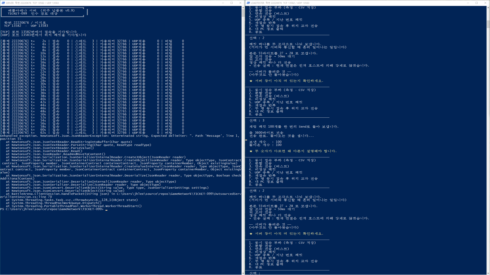
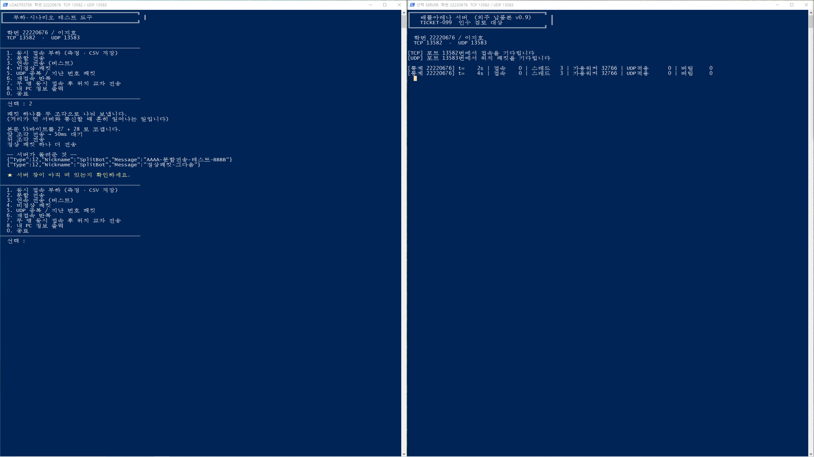

**원인** `OutsourcedServer/PacketHelper.cs` L51, L63

받은 바이트 수(반환값)를 확인하지 않고 딱 한 번만 읽는다. (A2도 같은 줄이지만 원인이 다르다. A2는 "기다리는 방식"이 문제다.)

TCP는 경계가 없는 스트림이라서 `Receive(buf, 0, size)` 는 요청한 만큼이 아니라 지금 도착해 있는 만큼만 돌려준다. 그런데 L63은 반환값을 버리고 다시 읽지 않는다. 그래서 본문이 27바이트만 와 있을 때 나머지 28바이트가 0으로 채워진 버퍼를 그대로 JSON으로 읽고, 55번째 글자에서 `Unterminated string` 예외가 난다. 뒤늦게 도착한 28바이트는 다음 패킷의 헤더로 잘못 읽힌다. 헤더를 읽는 L51도 4바이트를 다 받았는지 확인하지 않는다.

**수업 근거**

- 3주차 9쪽: TCP는 "스트림"이라 메시지가 붙어서 오기도 하고, "반대로 잘려서 올 수도 있습니다".
- 3주차 10쪽: "먼저 4바이트를 읽는다 → 그 다음 정확히 30바이트를 읽는다". 이렇게 하면 "붙어 와도 잘려 와도 정확히 나눌 수 있습니다".
- 5주차 실습 코드 PacketHelper.cs의 `ReceiveExactAsync` 는 `while (received < count)` 로 다 받을 때까지 반복해서 읽는다. 납품본에는 이 반복이 없다.

**고친 코드**
```csharp
// before (L51, L63)
int n = await Task.Run(() => socket.Receive(header, 0, 4, SocketFlags.None));
...
await Task.Run(() => socket.Receive(body, 0, bodyLength, SocketFlags.None));

// after: 요청한 바이트를 다 받을 때까지 반복
if (!await ReadExactAsync(socket, header, 4)) return null;   // 상대가 연결을 닫음
...
if (!await ReadExactAsync(socket, body, bodyLength)) return null;

private static async Task<bool> ReadExactAsync(Socket socket, byte[] buffer, int size)
{
    int read = 0;
    while (read < size)
    {
        int n = await Task.Run(() => socket.Receive(buffer, read, size - read, SocketFlags.None));
        if (n == 0) return false;   // 상대가 연결을 닫음
        read += n;
    }
    return true;
}
```
이 단계에서는 블로킹 `Receive` 를 일부러 그대로 두었다. 부분 수신과 부하 문제를 따로 고쳐서, 각각 고쳤을 때 숫자가 어떻게 바뀌는지 보려고 했다 (Part B 측정 ②).

---

### A2. 동시 접속 50명부터 로그인이 대부분 실패한다

**재현 방법**

1. 서버를 새로 띄운다.
2. LoadTester에서 `1` 을 누르고 그냥 엔터를 친다. 10·50·100·300·500명 순서로 돌고, 봇마다 접속 → 로그인 → WELCOME을 최대 10초 기다린다.
3. CSV의 성공/실패, 그리고 서버 통계 줄의 `접속` 과 `스레드` 를 본다.

**기대** 500명까지 대부분 성공하고, 사람이 늘수록 지연이 조금씩 늘어난다.

**실제** CSV 2026-10-27 23:48:58~23:49:48 행: 10명 10/0, 50명 19/31, 100명 22/78, 300명 28/272, 500명 44/456. 50명부터 p95 지연이 9,914ms로 LoadTester의 10초 한도에 붙는다. 같은 시간 서버 통계 줄은 `접속 14 | 스레드 15` → `접속 22 | 스레드 26` → `접속 41 | 스레드 42` → `접속 62 | 스레드 63` 이었다. 약 50초 동안 스레드가 12개에서 63개로, 1초에 하나 정도씩 늘었다 (`증거/logs/server_1027_233628.log` t=751~800s).

**증거**

- before: `측정결과_22220676.csv` 23:48:58~23:49:48 행, `증거/B1_before_load_결과_1027_235137.png`, 서버 로그 `증거/logs/server_1027_233628.log`
- 중간 (A1만 고친 뒤): 같은 CSV 2026-10-28 00:21:50~00:22:41 행, `증거/B2_mid_load_결과_1028_002253.png`, 서버 로그 `증거/logs/server_1028_002139.log` (서버 스레드 최고 83)
- after: 같은 CSV 2026-10-28 00:25:39~00:25:50 행, `증거/B3_after_load_진행_1028_002549.png`, `증거/B3_after_load_결과_1028_002559.png`, 서버 로그 `증거/logs/server_1028_002522.log`. 50명 50/0, 100명 100/0, 300명 299/1, 500명 499/1이었고 서버 스레드는 최고 32개였다.

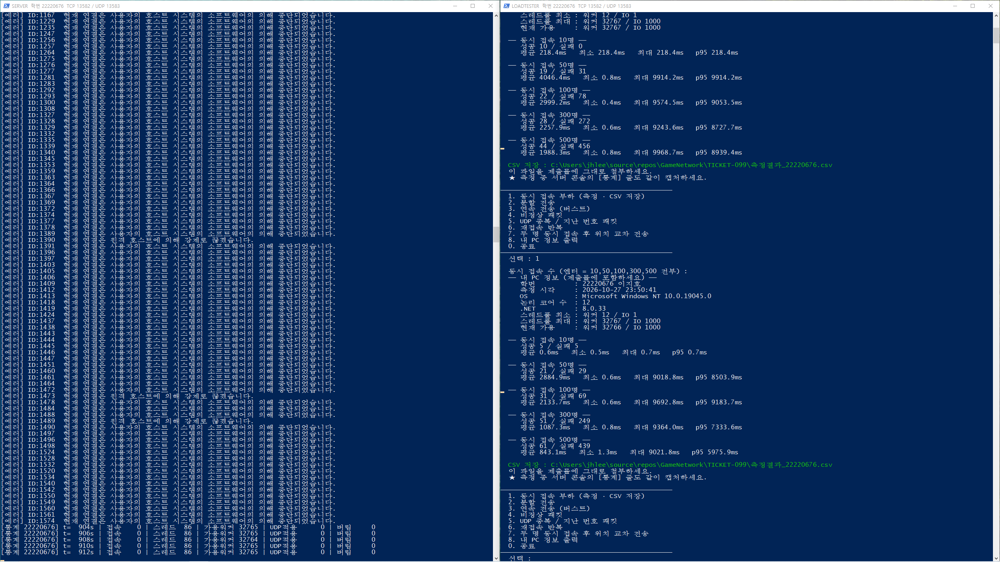
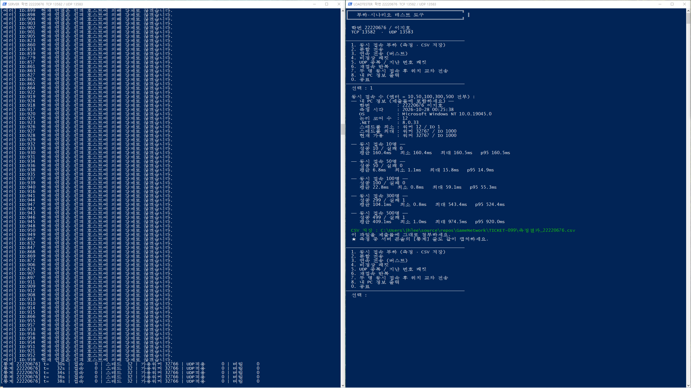

**원인** `OutsourcedServer/PacketHelper.cs` L51, L63

`Task.Run` 으로 감싼 블로킹 `Receive` 로 다음 패킷을 기다린다. (A1은 같은 줄에서 "반환값을 안 보는" 문제였다. A1만 고친 측정 ②에서도 부하 결과는 그대로였다.)

`Task.Run(() => socket.Receive(...))` 는 겉으로는 await를 쓰지만, 실제로는 스레드풀 스레드 하나가 데이터가 올 때까지 `Receive` 안에서 멈춰 있다. 로그인한 접속자는 다음 패킷을 기다리는 내내 스레드 하나를 붙잡고 있으니, 접속자 수가 곧 묶인 스레드 수가 된다. 통계 줄의 `접속 22 | 스레드 26`, `접속 62 | 스레드 63` 이 그 모습이다. 내 PC는 스레드풀이 처음에 바로 내주는 스레드가 12개(LoadTester 8번 "스레드풀 최소 : 워커 12")이고, 그 뒤로는 위 로그처럼 1초에 하나 정도씩만 늘어난다. 그래서 12명을 넘으면 새 접속 받기, LOGIN 처리, WELCOME 보내기 같은 일이 빈 스레드를 기다리며 줄을 선다. 자세한 숫자는 Part B에 정리했다.

**수업 근거**

- 4주차 16쪽 "흔한 실수: 네트워크 대기를 Task.Run 으로 감싸는 것 → 대기 중에는 CPU를 안 쓰는데, 쓰레드만 하나 더 잡아먹습니다 → 오히려 손해입니다". 납품본 L50 주석 "Receive는 블로킹 함수라서 Task.Run으로 감싸 비동기화했습니다"가 이 실수에 해당한다.
- 4주차 7쪽: 쓰레드 하나는 한 번에 한 가지 일만 하고, 그래서 "1명당 1쓰레드" 방식은 불가능하다.
- 4주차 8쪽 (C10K): 해결 방법은 "기다리는 동안 쓰레드를 놀리지 말자"이고, 그러면 "쓰레드 몇 개로 충분합니다".
- 4주차 11쪽: await는 "결과가 올 때까지 멈춘다. 단, 쓰레드는 반납한다."
- 4주차 19쪽: PacketHelper.cs의 "Receive → ReceiveAsync". 4·5주차 실습 코드도 `await socket.ReceiveAsync(...)` 를 쓴다.

**고친 코드**
```csharp
// before (A1을 고친 뒤의 ReadExactAsync 안)
int n = await Task.Run(() => socket.Receive(buffer, read, size - read, SocketFlags.None));

// after: 기다리는 동안 스레드를 돌려주는 비동기 수신
int n = await socket.ReceiveAsync(
    new ArraySegment<byte>(buffer, read, size - read), SocketFlags.None);
```

---

### A3. 형식이 깨진 패킷 하나로 서버 전체가 꺼진다

**재현 방법**

1. 서버를 새로 띄운다.
2. LoadTester에서 `4` 를 누른다. Type 필드가 없는 JSON을 보내고, 이어서 정상 채팅 `아직 살아있나요?` 를 보낸다.
3. 서버 창을 본다.

**기대** 그 패킷만 버리고, 다음 채팅은 정상으로 돌려준다.

**실제** 서버 창에 아래 예외가 찍히고 서버가 종료됐다.
```
Unhandled exception. Microsoft.CSharp.RuntimeBinder.RuntimeBinderException:
Cannot convert null to 'int' because it is a non-nullable value type
   at BattleArena.ClientSession.HandlePacket(String json) in …\ClientSession.cs:line 73
   at System.Threading.Tasks.Task.<>c.<ThrowAsync>…
```
LoadTester에는 `→ 전송 실패 : SocketException …` 와 "서버 창을 지금 바로 확인하세요"가 나왔다.

**증거**

- before: `증거/A3_before_malformed_1028_000210.png`, `증거/logs/server_1028_000158.log`
- after: `증거/A3_after_malformed_1028_001850.png`, `증거/logs/server_1028_001821.log`. 서버에 `[경고] ID:1 Type 없는 패킷을 버렸습니다` 가 찍힌 뒤에도 통계 줄이 계속 나왔다. LoadTester는 `{"Type":12,"Nickname":"BadBot","Message":"아직 살아있나요?"}` 를 받았다.

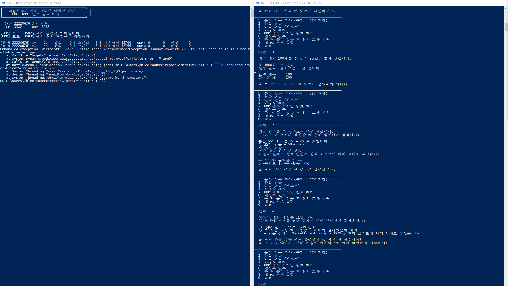
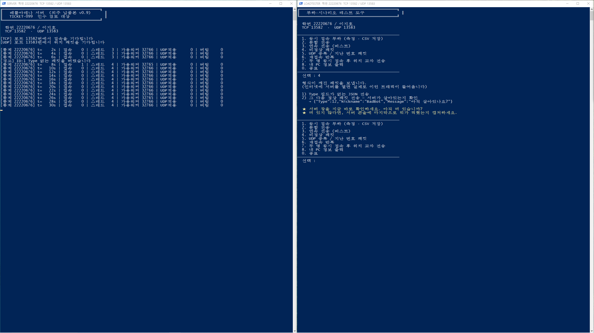

**원인** `OutsourcedServer/ClientSession.cs` L73, L68, L50

- L73: `Type` 이 없으면 `packet.Type` 이 null이고, `(int)null` 에서 예외가 난다.
- L68: `HandlePacket` 이 `async void` 다. 반환하는 Task가 없으니 예외를 담아 둘 곳도, 받아 줄 호출자도 없다. 그래서 예외가 스레드풀로 그대로 던져지고(스택의 `ThrowAsync`) 프로세스 전체가 죽는다.
- L50: `HandlePacket(json);` 을 await 없이 부른다. 그래서 RunAsync를 감싼 try/catch(L43–56)가 이 예외를 잡지 못한다.
- A1의 분할 전송 크래시도 같은 길로 죽었다. 두 스택 모두 `HandlePacket` → `ThrowAsync` 다.

**수업 근거**

- 4주차 19쪽: ClientSession.cs는 "Run() → RunAsync(), 내부 호출도 await".
- 4주차 12–13쪽: Task는 "미래에 완료될 작업"에 대한 접수증이고, 예외가 나면 그 Task가 `Faulted` 상태가 된다. 즉 예외가 Task에 담긴다. `async void` 는 이 Task 자체가 없다.
- 4주차 18쪽 "await 를 빼먹으면 생기는 일". 4주차 실습 예제 B 8번 메뉴 "예외는 어디로 가나"에는 "던져놓기를 할 때는 안에서 직접 try-catch 해야 합니다. 우리 서버의 ClientSession.RunAsync 를 보세요"라고 나온다. 납품본은 패킷 처리를 그 try 밖으로 빼 버렸다.
- 2주차 9쪽: 서버가 할 일 중 "치팅 방지: 이상한 요청 걸러내기". 이상한 패킷 하나는 버려야 하고, 그것 때문에 서버가 죽으면 안 된다.
- 5주차 실습 코드는 `private async Task HandlePacketAsync` 를 `await HandlePacketAsync(json);` 으로 부른다.

**고친 코드**
```csharp
// before
HandlePacket(json);                                   // L50
private async void HandlePacket(string json)          // L68
{
    dynamic? packet = JsonConvert.DeserializeObject(json);
    if (packet == null) return;
    int type = (int)packet.Type;                      // L73

// after
await HandlePacketAsync(json);                        // 예외가 RunAsync의 try-catch로 돌아옴

private async Task HandlePacketAsync(string json)
{
    int type;
    try
    {
        dynamic? packet = JsonConvert.DeserializeObject(json);
        if (packet is null) return;

        if (packet.Type == null)
        {
            Console.WriteLine($"[경고] ID:{PlayerId} Type 없는 패킷을 버렸습니다");
            return;
        }
        type = (int)packet.Type;
    }
    catch (Exception ex)
    {
        Console.WriteLine($"[경고] ID:{PlayerId} 해석할 수 없는 패킷을 버렸습니다 : {ex.Message}");
        return;
    }
    // 이하 switch 그대로
```

---

### A4. 위치 패킷 뒤에 이전 패킷 찌꺼기가 붙어 좌표가 틀어진다

**재현 방법**

1. 서버를 띄운다.
2. LoadTester에서 `6` 을 누른다. 접속 → 위치 전송 → 종료를 5번 반복한다. 회차마다 x = 회차 × 3, y는 1~10 사이 값이다.
3. 회차마다 찍히는 STATE에서 내 좌표를 본다.

**기대** y가 1~10 사이로 나온다.

**실제** 1회차 `STATE|2,ReBot1,3,1` 은 정상이었다. 그런데 2회차 `6,2109`, 3회차 `9,1109`, 4회차 `12,209`, 5회차 `15,110` 처럼 y 뒤에 앞 패킷의 끝 숫자가 붙어서 10을 넘었다. LoadTester는 매 회차 초록색으로 "STATE에 내가 있음"을 띄워서, 도구 판정만 보면 정상처럼 보인다.

**증거**

- before: `증거/A4_before_reconnect_1028_000500.png`, `증거/logs/server_1028_000351.log` (LT 5를 돌린 같은 서버에서 이어서 실행)
- after: `증거/A4_after_reconnect_1028_002841.png`, `증거/logs/server_1028_002818.log`. 회차별로 (3,1), (0,0), (9,1), (12,1), (15,2)가 나와 y가 모두 범위 안에 있었다.
- after 2회차의 (0,0)은 찌꺼기가 아니다. 서버는 첫 MOVE를 받으면 주소부터 등록하고(L122) 그다음에 좌표를 넣는다(L136–137). 그 사이에 브로드캐스트 루프(L157–161)가 STATE를 만들면 아직 0인 좌표가 그대로 나간다. 봇은 그 STATE 하나를 읽은 것이다.
- before는 LT 5를 돌린 서버에서 이어서 돌렸고, after는 새 서버에서 돌렸다. 찌꺼기는 같은 서버가 바로 앞에 받은 패킷에서 생긴다. 그래서 새 서버라도 2회차부터는 1회차 패킷이 찌꺼기로 남을 수 있는 조건이다. 같은 조건에서 after에는 찌꺼기가 없었다.

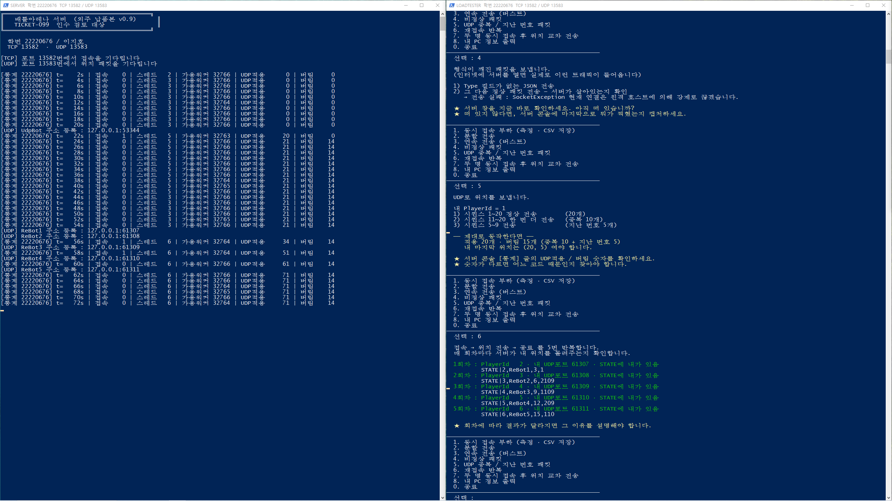
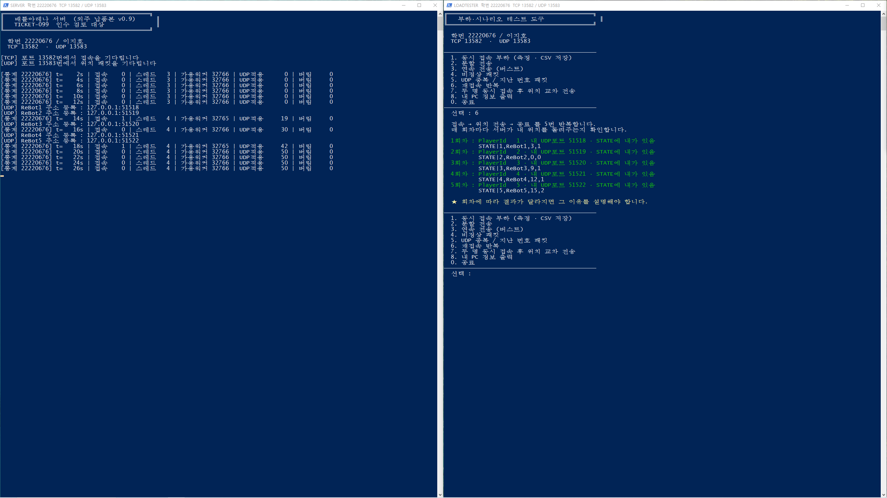

**원인** `OutsourcedServer/UdpServer.cs` L80

`Encoding.UTF8.GetString(buffer)` 는 1024바이트 버퍼 전체를 문자열로 바꾼다. 이번에 받은 길이(`result.ReceivedBytes`)를 쓰지 않으니, 이번 패킷이 앞 패킷보다 짧으면 앞 패킷의 끝부분이 버퍼에 남아 있다가 마지막 칸(y) 뒤에 붙는다. 그 뒤의 `\0` 은 `int.TryParse` 가 무시해서 파싱은 성공한다. 그래서 UDP적용 숫자도 정상처럼 올라간다.

**수업 근거**

- 5주차 13쪽: MOVE 패킷은 `MOVE | 3 | 152 | 10 | 7` 순서이고 y가 맨 마지막 칸이다. 그래서 찌꺼기가 y에 붙는다.
- 5주차 학생용 실습 코드 TODO 2 힌트: "반환값에서 꺼낼 것 … result.ReceivedBytes 받은 바이트 수".
- 5주차 실습 코드 UdpServer.cs와 예제 E(PositionSync) 모두 `Encoding.UTF8.GetString(buffer, 0, result.ReceivedBytes)` 로 받은 만큼만 읽는다.
- 3주차 10쪽 "정확히 30바이트를 읽는다": TCP에서처럼 받은 길이만큼만 읽어야 한다는 같은 원칙이다.

**고친 코드**
```csharp
// before (L80)
string msg = Encoding.UTF8.GetString(buffer);
// after: 이번에 받은 바이트 수만큼만 문자열로
string msg = Encoding.UTF8.GetString(buffer, 0, result.ReceivedBytes);
```

---

### A5. 같은 번호(중복) 위치 패킷을 버리지 않는다

**재현 방법**

1. 서버를 새로 띄우고, 통계 줄이 `UDP적용 0 | 버림 0` 인지 확인한다.
2. LoadTester에서 `5` 를 누른다. 시퀀스 1~20을 정상으로 보내고, 11~20을 한 번 더(중복 10개), 5~9를(지난 번호 5개) 보낸다.
3. 다음 통계 줄의 UDP적용과 버림을 본다.

**기대** LoadTester 안내대로 적용 20개, 버림 15개, 마지막 위치 (20, 5).

**실제** `UDP적용 21 | 버림 14`. 중복 10개 중 seq 20 하나가 버려지지 않고 적용됐다.

**증거**

- before: `증거/A5_before_udpdup_1028_000419.png`, `증거/logs/server_1028_000351.log` (실행 전 0/0 → 실행 후 21/14)
- after: `증거/A5_after_udpdup_1028_003550.png`, `증거/logs/server_1028_003525.log`. 0/0 → 20/15로 기대값과 같았다.

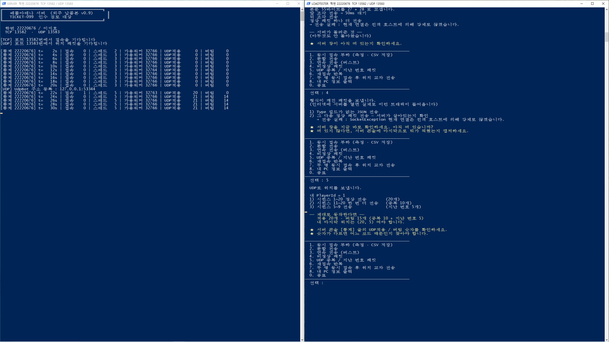
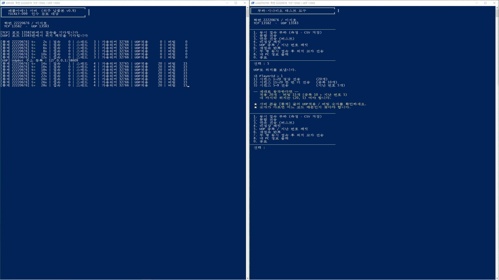

**원인** `OutsourcedServer/UdpServer.cs` L129

`seq < LastSeq` 는 이미 적용한 번호와 같은 번호를 통과시킨다. UDP는 같은 데이터그램이 두 번 도착할 수도 있으니 같은 번호도 버려야 한다. 이번 재현에서는 마지막으로 적용한 번호가 20이어서, 두 번째로 온 20만 다시 적용됐다.

**수업 근거**

- 5주차 14쪽 "규칙은 한 줄입니다: 가진 번호보다 작거나 같으면 버린다". 슬라이드 코드도 `if (seq <= session.LastSeq) return;` 이다.
- 5주차 13쪽 "시퀀스 번호는 왜: UDP는 순서를 보장하지 않습니다".
- 5주차 학생용 실습 코드 TODO 3 힌트 "지금 받은 seq 가 그것보다 작거나 같으면? → 오래된 패킷이므로 return 으로 버리세요".
- 5주차 실습 코드 UdpServer.cs와 PositionSync도 `<=` 를 쓴다.

**고친 코드**
```csharp
// before (L129)
if (seq < session.LastSeq)
// after: 작거나 같으면 버린다 (중복 패킷도 버림)
if (seq <= session.LastSeq)
```

---

### A6. 남의 PlayerId를 적어 보내면 그 사람 위치가 바뀐다

**재현 방법**

1. 서버를 띄운다.
2. LoadTester에서 `7` 을 누른다. BotA와 BotB가 접속해 각자 위치를 하나씩 보낸 뒤, B가 자기 소켓으로 `MOVE|<A의 ID>|9999|30|15` 를 보낸다.
3. 다음 통계 줄에서 UDP적용이 얼마나 늘었는지 본다.

**기대** B가 A의 ID로 보낸 위조 패킷은 버려지고, UDP적용은 2만 늘어난다 (A 1개 + B 1개).

**실제** UDP적용이 71 → 74로 3 늘었다. 위조 패킷까지 A의 위치에 적용됐다. LT 5·6을 돌린 같은 서버에서 이어서 실행해서 누적값이 71부터 시작한다. after는 새 서버라 0부터 시작해서, 두 경우 모두 "늘어난 양"으로 비교했다.

LoadTester 화면은 초록색 "A의 위치가 (5,5) 에서 안 바뀌었습니다."로 나와서 정상처럼 보인다. 그런데 도구 코드를 보면 A의 소켓에 쌓인 STATE 중 맨 앞의 것 하나만 읽는다 (LoadTester Program.cs L599–603, `ReceiveFrom` 1번). 실제로 화면에 찍힌 STATE도 `STATE|7,BotA,5,5` 로 BotB가 아직 들어 있지 않았다. B의 첫 MOVE보다도 먼저 쌓인 STATE라는 뜻이다. 그래서 이 시나리오에서는 초록 판정으로 위조 여부를 알 수 없었고, 서버 통계로 판단했다.

**증거**

- before: `증거/A6_before_spoof_1028_000518.png`, `증거/logs/server_1028_000351.log` (`[UDP] BotA 주소 등록`, `BotB 주소 등록` 뒤 UDP적용 71 → 74)
- after: `증거/A6_after_spoof_1028_003726.png`, `증거/logs/server_1028_003711.log`. `[UDP 경고] 127.0.0.1:57016 에서 ID 1(BotA) 로 보낸 MOVE 를 버렸습니다 (등록 주소 127.0.0.1:57015)` 가 찍혔고 UDP적용은 0 → 2였다.

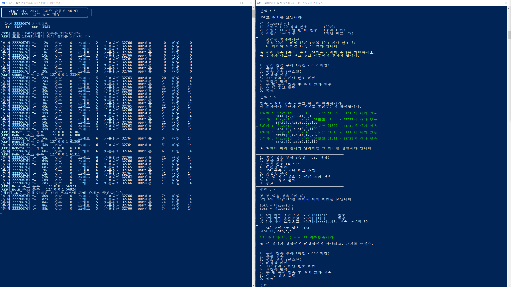
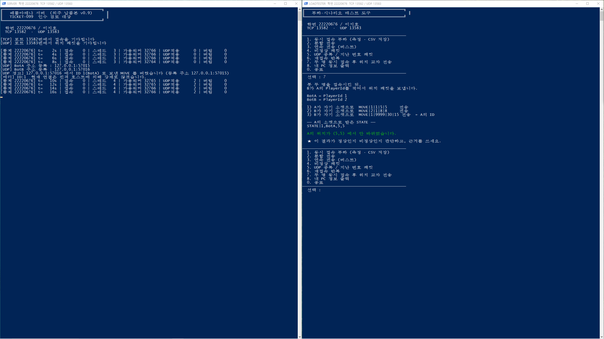

**원인** `OutsourcedServer/UdpServer.cs` L115–124

UDP 서버는 소켓 하나로 모든 사람의 패킷을 받는다. 그러니 누가 보냈는지를 패킷 안의 PlayerId만 보고 믿으면 안 된다. L120–124는 첫 패킷의 주소만 기억하고, 그 뒤로는 어느 주소에서 왔든 ID만 맞으면 적용한다.

5주차 BattleArenaServer 실습 코드도 이 부분은 같은 구조다. 그래도 결함으로 판단한 이유는 세 가지다.

- 공지문이 비교 기준으로 권한 예제 E(PositionSync)는 보낸 주소(`from.ToString()`)를 키로 플레이어를 찾는다.
- 측정 도구인 LoadTester 7번이 이 상황을 빨간색 "A는 그 패킷을 보낸 적이 없습니다"로 잡도록 만들어져 있다.
- 실제로 남의 위치를 바꿀 수 있었다.

**수업 근거**

- 5주차 11쪽: UDP에는 Listen도 Accept도 없고, "ReceiveFrom으로 '누가 보냈는지'를 같이 받습니다. 그걸로 구분해야 합니다."
- 5주차 12쪽: "UDP는 소켓 하나에 전부 섞여 들어옴", `r.RemoteEndPoint = 보낸 사람 주소 (IP + 포트)`.
- 2주차 9쪽: 서버가 할 일 "치팅 방지: 이상한 요청 걸러내기".

**고친 코드**
```csharp
// before (L120–124)
if (session.UdpEndPoint == null)
{
    session.UdpEndPoint = from;
    Console.WriteLine($"[UDP] {session.Nickname} 주소 등록 : {from}");
}

// after: 등록된 주소가 아니면 버림
if (session.UdpEndPoint == null)
{
    session.UdpEndPoint = from;
    Console.WriteLine($"[UDP] {session.Nickname} 주소 등록 : {from}");
}
else if (!session.UdpEndPoint.Equals(from))
{
    Console.WriteLine($"[UDP 경고] {from} 에서 ID {playerId}({session.Nickname}) 로 보낸 MOVE 를 버렸습니다 (등록 주소 {session.UdpEndPoint})");
    return;
}
```
이 수정에도 한계가 두 가지 있다.

1. 진짜 주인보다 남이 먼저 첫 패킷을 보내면 그 사람 주소가 등록된다. 완전히 막으려면 WELCOME에 비밀값을 실어 보내고 MOVE에 같이 넣게 해야 하는데, 프로토콜을 바꾸는 일이라 이번에는 하지 않았다.
2. 위조 패킷마다 경고를 한 줄씩 찍는다. 위조가 쏟아지면 Part C 의견 4에서 말한 것처럼 로그가 콘솔을 덮을 수 있다. 실제로 쓸 서버라면 버린 횟수를 통계 줄에 숫자로 세는 편이 낫다. 이번에는 증거를 남기려고 한 줄 경고로 두었다.

---

### A7. 테스트 클라이언트가 다른 사람 위치(STATE)를 못 받는다

**재현 방법**

1. 서버를 새로 띄우고 TestClient를 2개 띄운다 (닉네임 Alice, Bob).
2. 두 창에서 WASD로 움직인다.
3. 화면의 `보이는 사람` 줄, `[UDP 문제]` 줄, 서버 통계의 UDP적용을 본다.

**기대** 서로의 기호가 지도에 보인다.

**실제** 두 창 모두 `[UDP 문제] 수신 중단 : InvalidOperationException You must call the Bind method before performing this operation.` 이 뜨고 `보이는 사람 : 없음` 이었다. 같은 시간 서버에는 `[UDP] Bob 주소 등록`, `Alice 주소 등록` 이 찍혔고 UDP적용이 5 → 16으로 올라갔다. 서버는 위치를 잘 받고 있고, 클라이언트가 STATE를 못 받고 있는 것이다.

**증거** (after에서는 닉네임을 소문자 alice, bob으로 넣었다)

- before: `증거/A7_before_testclient_1027_235434.png`, `증거/logs/server_1027_235324.log`
- after: `증거/A7_after_testclient_1028_001600.png`, `증거/logs/server_1028_001515.log`. alice 창에 `A bob(5,7)`, bob 창에 `A alice(10,1)` 이 보였고 `[UDP 문제]` 줄은 없었다.

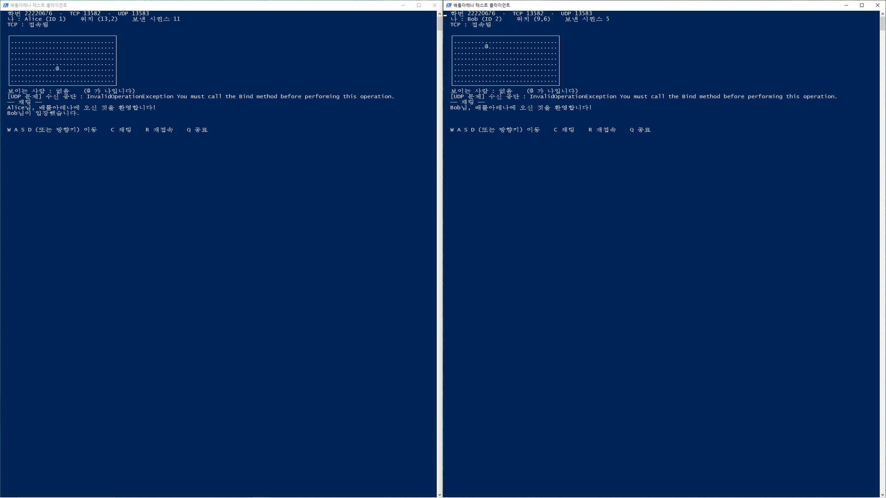
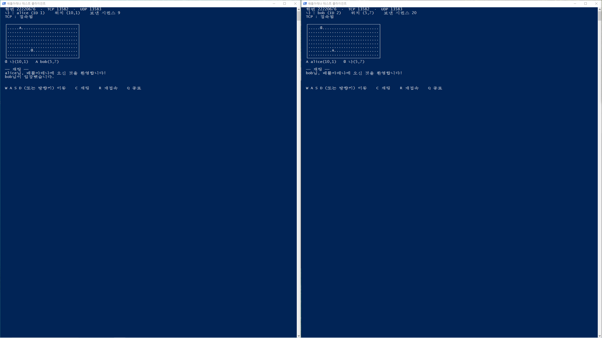

**원인** `TestClient/Program.cs` L149–161

UDP 소켓을 만들고 `Bind` 없이 바로 `ReceiveFromAsync`(L347)를 부른다. 내 쪽 포트가 정해지지 않은 소켓으로는 받을 수 없어서 예외가 난다. 그러면 L352–356의 catch가 `break` 로 수신 루프를 끝내 버려서, 그 뒤로 STATE를 하나도 받지 않는다. 보내기는 SendTo가 알아서 포트를 잡아 주기 때문에 되고, 그래서 서버 쪽 숫자만 보면 정상처럼 보인다.

**수업 근거**

- 3주차 7쪽: 서버 코드가 하는 일 4가지 중 첫 번째가 Bind ("나는 7777번 포트를 쓰겠다"고 선언).
- 5주차 11쪽: UDP 서버도 `socket.Bind(ep);` 를 한 뒤에 `ReceiveFromAsync` 로 받는다.
- 5주차 실습 README "Bind가 왜 필요한가": "SendTo → OS가 포트를 자동 할당 → Bind 없어도 됨 / ReceiveFrom → 받을 포트가 정해져 있어야 함 → Bind 필수".
- 예제 E(PositionSync) 주석 "받으려면 Bind가 필요합니다 … 수신 루프를 먼저 시작하는 구조라면 반드시 Bind해야 합니다."

**고친 코드**
```csharp
// before (L153–156)
_udp = new Socket(AddressFamily.InterNetwork, SocketType.Dgram, ProtocolType.Udp);
_udpServer = new IPEndPoint(IPAddress.Parse(SERVER_IP), StudentConfig.UdpPort);

// after
_udp = new Socket(AddressFamily.InterNetwork, SocketType.Dgram, ProtocolType.Udp);
_udp.Bind(new IPEndPoint(IPAddress.Any, 0));   // 포트 0 = OS가 빈 포트를 골라 줌
_udpServer = new IPEndPoint(IPAddress.Parse(SERVER_IP), StudentConfig.UdpPort);
```

---

### A8. 다른 사람이 나가도 퇴장 알림이 오지 않는다

**재현 방법**

1. 서버를 띄우고 TestClient 2개(닉네임 Alice, Bob)를 띄운다.
2. Alice 창의 채팅 칸에 `Bob님이 입장했습니다.` 가 뜬 것을 확인한다.
3. Bob 창에서 `Q` 를 눌러 종료한다.

**기대** Alice 창에 `Bob님이 나갔습니다.` (Type 21 퇴장 알림)가 뜬다.

**실제** 입장 알림만 있고 아무것도 뜨지 않았다.

**증거**

- before: `증거/A8_before_leave_1027_235506.png`, `증거/logs/server_1027_235324.log` (A7과 같은 서버)
- after: `증거/A8_after_leave_1028_003927.png`, `증거/logs/server_1028_003901.log`. alice 창에 `bob님이 입장했습니다.` 다음 줄로 `bob님이 나갔습니다.` 가 떴다.

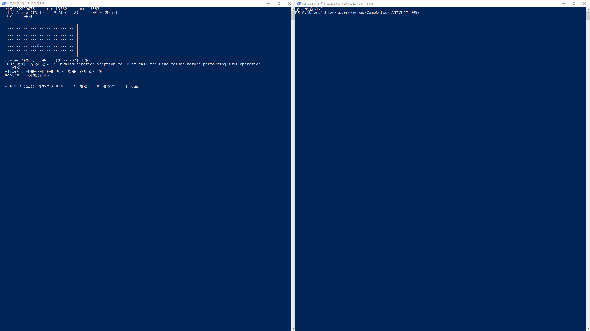
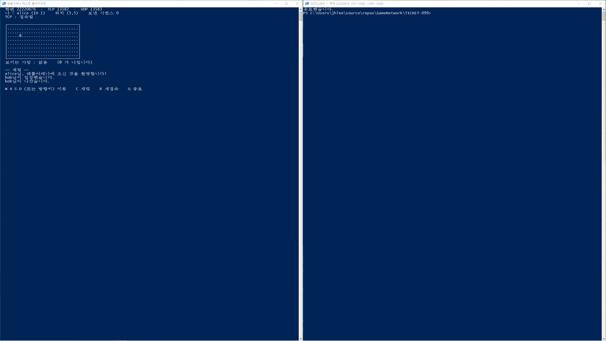

**원인** `OutsourcedServer/ClientSession.cs` L148–161

`Disconnect()` 가 세션만 지우고(L160) 남은 사람에게 퇴장 알림을 보내지 않는다. 납품본 README의 통신 규약에도 "20 / 21 입장 / 퇴장 알림"이 있고, TestClient도 Type 21을 받으면 화면에 띄우도록 만들어져 있다(L308). 보내는 쪽만 빠져 있다.

**수업 근거**

- 3주차 11쪽 우리가 쓸 패킷 규칙: "Type 20 입장 알림, Type 21 퇴장 알림".
- 4·5주차 실습 코드의 `Disconnect()` 는 `PLAYER_OUT` 을 브로드캐스트한다.

**고친 코드**
```csharp
// before (L160): 세션만 지우고 끝
GameServer.Instance.RemoveSession(PlayerId);

// after
GameServer.Instance.RemoveSession(PlayerId);
// 남은 사람들에게 퇴장 알림 (4·5주차 실습 코드와 같음)
GameServer.Instance.Broadcast(new NoticePacket
{
    Type    = PacketType.PLAYER_OUT,
    Message = $"{Nickname}님이 나갔습니다."
});
```

---

### 살펴봤지만 결함이 아니라고 판단한 곳

5주차 코드와 다르거나 문제처럼 보였지만, 돌려 보거나 수업 내용과 맞춰 본 뒤 고치지 않기로 한 곳이다. 보고 대상(감점 대상)에는 넣지 않았다.

| 위치 (원본) | 판단 | 이유 |
|---|---|---|
| GameServer.cs L72 `_ = session.RunAsync();` | 정상 (5주차와 같음) | 4주차 17쪽 던져놓기 패턴이다. await를 붙이면 동시 접속이 1명이 된다. Part C 의견 3에서 직접 돌려 확인했다 |
| GameServer.cs L50 `Listen(512)` (5주차 100) | 더 나음 | 3주차 8쪽 "Listen(100) 동시에 100개까지 대기시킬 수 있음". 이 서버는 500명 동시 접속을 재는 서버라 대기 줄이 길어야 한다 |
| GameServer.cs L65 `NoDelay = true` (5주차 없음) | 더 나음 | 작은 채팅·알림 패킷을 모으지 않고 바로 보낸다. Part C 의견 8 |
| PacketHelper.cs L33–39 보내기 반복 (5주차 한 번) | 더 나음 | 3주차 9쪽처럼 스트림은 잘릴 수 있으니, 보내는 쪽도 다 보낼 때까지 반복하는 편이 안전하다 |
| UdpServer.cs L26 `_stateBuilder` 필드 (5주차 지역 변수) | 더 나음 | 브로드캐스트 루프 하나만 쓰고, 틱마다 새로 만들지 않아 할당이 준다. Part C 의견 9 |
| UdpServer.cs L22 `TICK_MS = 33` | 정상 (5주차와 같음) | 5주차 16쪽 `await Task.Delay(33); // 약 30fps`. Part C 의견 5 |
| UdpServer.cs L51–56 `IOControl` | 더 나음 | 윈도우에서 상대가 사라졌을 때 오는 UDP 오류(10054) 때문에 수신 루프가 끊기지 않게 하는 설정이다 (강의자료에는 없는 내용) |
| UdpServer.cs L177 `catch { }` | 정상 | 5주차 16쪽 "실패해도 무시: 33ms 뒤에 또 보내니까". Part C 의견 4 |
| PacketHelper.cs L19 `MAX_BODY = 8192` (5주차 65535) | 정상 | TestClient(L257)도 8192로 맞춰져 있다. Part C 의견 6 |
| GameServer.cs L70 접속 즉시 세션 등록 | 5주차와 같음 | Part B에서 남은 실패 1건을 설명할 때만 썼고, 결함으로는 보고하지 않았다 |
| LT 3 버스트 | 정상 | 내 PC에서 보낸 100개, 돌아온 100개 (`증거/X_burst_정상확인_1027_235737.png`). 붙어서 온 패킷도 길이 헤더로 잘 나뉜다 (3주차 10쪽) |

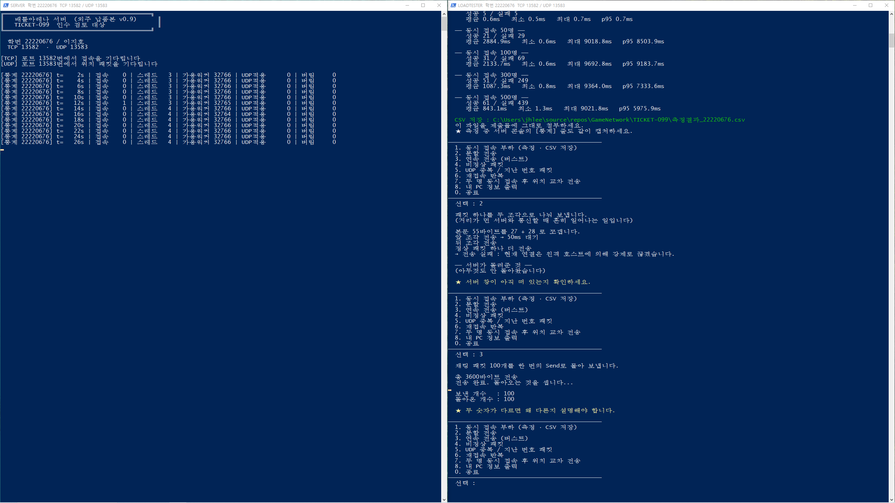

---

## Part B — 몇 명까지 버티나

### B-1. 측정 환경 (CSV + 내 PC 정보)

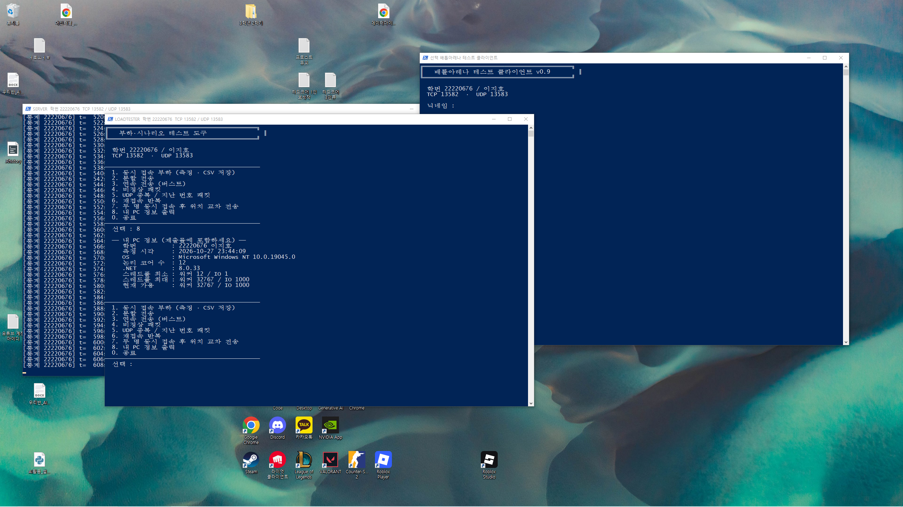

| 항목 | 값 (LoadTester 8번) |
|---|---|
| OS | Microsoft Windows NT 10.0.19045.0 |
| 논리 코어 수 | 12 |
| .NET | 8.0.33 |
| 스레드풀 최소 | 워커 12 / IO 1 |
| 스레드풀 최대 | 워커 32767 / IO 1000 |

측정 파일은 `측정결과_22220676.csv` 이고, LoadTester가 만든 파일을 그대로 넣었다. 한 파일에 측정한 순서대로 행이 쌓여 있다.

| 측정 | 코드 상태 | CSV 측정시각 |
|---|---|---|
| ① 원본 | 납품본 그대로 (학번만 입력) | 2026-10-27 23:48:58 ~ 23:49:48 |
| ①-재 | 원본, 서버를 다시 띄우지 않고 한 번 더 | 2026-10-27 23:50:41 ~ 23:51:32 |
| ② A1 수정 후 | 부분 수신만 고침 (블로킹 수신은 그대로) | 2026-10-28 00:21:50 ~ 00:22:41 |
| ③ A2 수정 후 | 수신을 ReceiveAsync로 바꿈 | 2026-10-28 00:25:39 ~ 00:25:50 |
| 실험 | `exp/vendor-3` (업체 의견 3, 10명) | 2026-10-28 00:42:14 |

CSV의 `스레드수`, `가용워커` 열은 LoadTester 프로세스의 값이다. 서버의 스레드 수는 서버 통계 줄(`증거/logs/`)에서 따로 옮겼다.

### B-2. 어느 구간부터 나빠지나

CSV에서 그대로 옮긴 값이다 (성공/실패, 평균 / p95 ms).

| 동시 접속 | ① 원본 | ① 평균 / p95 | ② A1 후 | ③ A2 후 | ③ 평균 / p95 |
|---|---|---|---|---|---|
| 10 | 10 / 0 | 218.4 / 218.4 | 10 / 0 | 10 / 0 | 160.4 / 160.5 |
| 50 | **19 / 31** | 4046.4 / 9914.2 | 18 / 32 | 50 / 0 | 6.8 / 14.9 |
| 100 | 22 / 78 | 2999.2 / 9053.5 | 20 / 80 | 100 / 0 | 22.8 / 55.3 |
| 300 | 28 / 272 | 2257.9 / 8727.7 | 35 / 265 | 299 / 1 | 104.1 / 524.4 |
| 500 | 44 / 456 | 1988.3 / 8939.4 | 55 / 445 | 499 / 1 | 409.1 / 920.0 |

원본은 10명까지는 전부 성공했고, 50명에서 19명만 성공했다. 10명과 50명 사이 인원은 따로 재지 않았기 때문에, 내가 숫자로 말할 수 있는 건 "10명은 버티고 50명에서 무너진다"까지다. LoadTester의 평균·p95는 성공한 봇만으로 계산한다. 50명에서 성공한 봇의 p95가 9,914ms라서, 성공한 봇도 WELCOME 대기 한도(10초) 직전에 겨우 받은 것이다. 나머지는 10초 안에 WELCOME을 못 받아 실패로 처리됐다. 서버 통계의 접속 수는 계속 늘고 있었으니 접속 자체를 거절한 것은 아니다. 100·300·500명에서도 성공은 22·28·44명에 그쳤다. 사람 수를 10배로 늘려도 성공 수는 두 배 남짓밖에 늘지 않았는데, 이것은 아래 표처럼 서버 스레드가 늘어나는 속도와 비슷하다.

측정 ① 동안의 서버 통계 (`증거/logs/server_1027_233628.log`):

| 서버 t | 접속 | 서버 스레드 | 그때 LoadTester 단계 |
|---|---|---|---|
| 751s | 0 | 12 | 10명 끝 |
| 754s | 14 | 15 | 50명 |
| 762s | 22 | 26 | 50명 |
| 773s | 31 | 32 | 100명 |
| 786s | 41 | 42 | 300명 |
| 800s | 62 | 63 | 500명 |

접속 수와 스레드 수가 거의 똑같이 움직인다. 접속한 사람 한 명이 스레드 하나를 쥐고 있다는 뜻이다. 2초마다 찍혀야 하는 통계 줄도 500명 단계에서는 t=788s 다음이 t=800s로 12초나 벌어졌다. 통계를 찍는 작업도 빈 스레드를 기다렸기 때문이다.

서버를 다시 띄우지 않고 한 번 더 돌린 ①-재에서는 10명에서도 5명이 실패했다 (5/5). 직전 서버 통계는 접속 0, 스레드 3이었다 (t=852s). 왜 10명에서 실패했는지는 따로 확인하지 못했다. B-4에 적은 "로그인 전에 입장 알림이 먼저 가는" 구조 때문일 수도 있다고 생각한다. 조건을 맞추려고 이후 측정 ②·③은 매번 서버를 새로 띄워서 했다. 아래 진행 캡처는 ①-재(23:50 실행) 때 찍은 것이다. 측정 ①의 서버 통계는 위 표처럼 로그에서 옮겼다.

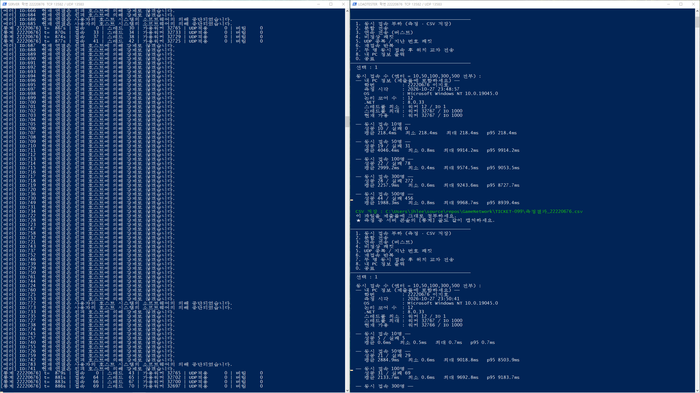

### B-3. 왜 거기서 나빠지나 (코드의 어느 줄 때문인가)

원인 줄: `OutsourcedServer/PacketHelper.cs` L51, L63 `await Task.Run(() => socket.Receive(...))`

| 질문 | 답 (내 숫자로) |
|---|---|
| 내 PC 코어 수는 몇인가 | 12개. 스레드풀이 처음에 바로 내주는 워커 스레드도 12개다 (LoadTester 8번 "스레드풀 최소 : 워커 12") |
| 접속자 한 명이 서버 자원을 어떻게 잡아먹나 | 로그인한 뒤 다음 패킷을 기다리는 동안 L51의 `socket.Receive` 가 스레드풀 스레드 하나를 붙잡고 멈춰 있다. 기다리는 동안 CPU는 안 쓰는데 스레드는 계속 묶인다 (4주차 16쪽 "쓰레드만 하나 더 잡아먹습니다"). 측정 ①의 접속 22에 스레드 26, 접속 62에 스레드 63이 그 결과다 |
| 왜 어느 숫자를 넘으면 갑자기 느려지나 | 묶인 스레드가 최소치 12를 넘으면 남은 일(다음 접속 받기, LOGIN 처리, WELCOME 보내기)이 빈 스레드를 기다리며 줄을 선다. 스레드풀은 그 뒤로 스레드를 천천히만 늘린다. 내 로그에서는 12개에서 63개까지 약 50초, 1초에 하나 정도였다. LoadTester는 WELCOME을 10초까지만 기다리므로 50명 단계부터 대부분이 시간 안에 못 받았다 (p95 9,914ms). 4주차 7쪽에서 배운 "1명당 1쓰레드는 불가능"이 내 PC에서는 12명을 넘는 순간부터 보였다 |
| 고치면 왜 빨라지나 | `socket.ReceiveAsync` 는 기다리는 동안 스레드를 돌려준다 (4주차 11쪽 "쓰레드는 반납한다"). 데이터가 왔을 때만 잠깐 스레드를 빌려 처리하므로 접속자 수와 스레드 수가 따로 논다. 측정 ③에서 `접속 294 / 스레드 12` (서버 t=24s)였고, 스레드는 최고 32개로 500명 중 499명이 성공했다 (`증거/logs/server_1028_002522.log`). 4주차 8쪽 "쓰레드 몇 개로 충분합니다"가 그대로 나왔다 |

② (A1만 고친 측정)은 ①과 거의 같았다. 50명 18/32, 500명 55/445였고 서버 스레드는 최고 83개였다 (`증거/logs/server_1028_002139.log`). 나뉘어 온 패킷을 끝까지 읽게 고쳐도 동시 접속 실패는 그대로였다. 그래서 부하 문제의 원인은 부분 수신이 아니라, 기다리는 동안 스레드를 붙잡는 블로킹 수신이라고 판단했다.

### B-4. 고친 뒤 다시 측정

측정 ③ (A2 수정 후, CSV 2026-10-28 00:25:39~00:25:50): 10명 10/0, 50명 50/0, 100명 100/0, 300명 299/1, 500명 499/1. p95는 500명에서도 920ms였다. 서버 스레드는 최고 32개였다 (`증거/logs/server_1028_002522.log`). 측정이 12초 만에 끝나서 `B3_after_load_진행` 캡처는 거의 끝날 때 찍혔다.


300명과 500명에서 1건씩 남은 실패는 코드를 따라가 보면 이렇게 생긴다. 서버는 접속하자마자 세션을 목록에 넣고(GameServer.cs L70), 입장 알림 Broadcast(L125–132)는 로그인 여부와 상관없이 목록 전체에 보낸다. 그래서 아직 WELCOME을 받기 전인 봇이 다른 봇의 입장 알림(Type 20)을 먼저 받을 수 있다. LoadTester는 첫 패킷이 WELCOME(Type 11)이 아니면 실패로 센다. 5주차 코드도 같은 구조라서 Part A 결함으로는 보고하지 않았다.

---

## Part C — 업체 검토서 판정

### C-1. 판정표

판정 기준은 "업체 권고대로 바꿔야 하느냐"로 잡았다. 업체 말에 맞는 내용이 일부 있어도, 권고대로 바꾸면 안 되면 반대로 판정했다.

| 의견 | 판정 | 근거 | 수업 근거 |
|---|---|---|---|
| 1. TCP/UDP 분리는 적절 | 동의 | 로그인·채팅은 하나라도 빠지면 안 되니 TCP, 위치는 33ms 뒤 새 값이 또 오니 최신 값만 중요해서 UDP가 맞다 | 5주차 8–9쪽 "그래서 둘 다 씁니다: TCP 7777(로그인·채팅) + UDP 7778(위치)" |
| 2. STATE를 묶어 보내기 | 동의 | 한 틱에 전원에게 STATE 하나씩만 보내니 100명이면 9,900개가 아니라 100개다 | 5주차 13쪽 "따로 보내면 패킷 수가 늘어나서 오히려 손해", 5주차 16쪽, 학생용 실습 코드 TODO 4 "100명이면 9,900개 vs 100개" |
| 3. await 누락 | 반대 | RunAsync는 그 사람이 나갈 때까지 안 끝나서, await를 붙이면 Accept 루프가 첫 사람에게 묶인다. 직접 돌려 보니 10명 중 1명만 성공했다 (C-2) | 4주차 17쪽 던져놓기 패턴 "await 를 붙이면 … 다음 손님을 못 받음", 4주차 3·6쪽 TICKET-007 |
| 4. 빈 catch는 안티패턴 | 반대 | 위치는 33ms 뒤 다음 틱에 새 값으로 또 보내니 실패를 기록하거나 다시 보낼 이유가 없다. 실패가 몰릴 때 로그를 찍으면 통계 줄이 묻힌다 | 5주차 16쪽 "실패해도 무시: 33ms 뒤에 또 보내니까", 5주차 9쪽 "10번 좌표 유실 → 33ms 뒤 11번 도착 → 아무도 모름" |
| 5. Task.Delay(33)은 부정확 | 반대 | 30fps에 정확히 맞출 필요가 없고, 받는 쪽은 보간으로 부드럽게 맞춘다. 수업 코드도 33을 쓴다 | 5주차 16쪽 `await Task.Delay(33); // 약 30fps`, "60번은 낭비, 10번은 끊김", 5주차 19쪽 보간 |
| 6. MAX_BODY 8192는 작다 | 반대 | 8192바이트면 채팅에 충분하다. 서버만 65535로 올리면 TestClient(L257, 8192)가 긴 채팅을 받는 순간 연결이 끊긴다 | 3주차 10쪽 길이 헤더 (길이는 양쪽이 같은 규칙으로 읽어야 한다) |
| 7. Listen(512)는 과하다 | 반대 | 백로그는 Accept를 기다리는 접속 줄의 길이다. 500명이 한꺼번에 붙는 서버인데 100으로 줄이면 몰릴 때 접속이 거절될 수 있다 | 3주차 8쪽 "Listen(100) 동시에 100개까지 대기시킬 수 있음" |
| 8. NoDelay는 대역폭 낭비 | 반대 | 이 서버의 TCP 패킷은 작은 채팅·알림이라 대역폭보다 지연이 더 문제다. Nagle은 작은 패킷을 모으느라 지연을 만든다 | 5주차 5–6쪽: TCP가 기다리는 동작이 "게임에서는 독이 됩니다" (Nagle 자체는 강의자료에 없음) |
| 9. StringBuilder 필드는 위험 | 반대 | `_stateBuilder` 는 브로드캐스트 루프 한 곳에서만 쓰고, Clear → Append → ToString(L154–163) 사이에 await가 없다. 동시에 건드리는 코드가 없으니 섞이지 않는다 | 5주차 16쪽 BroadcastLoopAsync는 루프 하나, 4주차 15쪽 await와 await 사이는 한 조각으로 이어서 실행 |
| 10. 부하 테스트 불필요 | 반대 | 수신이 Task.Run 안의 블로킹 Receive라서 접속자마다 스레드를 하나씩 붙잡는다. 직접 돌려 보니 50명부터 31명이 실패했다 (C-3) | 4주차 16쪽 "흔한 실수", 4주차 4쪽 "신고를 받으면 먼저 재현부터 합니다" |

반대로 판정한 것 중 업체 말이 아주 틀리지는 않은 것도 있어서 따로 적는다.

- 의견 5: 33ms면 약 30.3fps인 것도, Task.Delay가 OS 타이머 영향을 받는 것도 맞다. 하지만 간격이 조금 흔들려도 보간 때문에 화면에서는 차이가 안 난다. 그래서 고정밀 타이머나 보정 루프로 바꿀 이유가 없다고 봤다.
- 의견 6: 8192바이트를 넘는 채팅이 거부되는 것은 맞다. 하지만 상한은 이상한 길이를 막으려고 두는 값이고, 바꾸려면 서버와 클라이언트를 같이 바꿔야 한다.
- 의견 8: NoDelay를 켜면 작은 패킷이 모이지 않고 나가서 패킷 수가 늘 수 있는 것은 맞다. 하지만 채팅·알림 정도의 양에서는 대역폭보다 반응 속도가 중요하다고 판단했다.

### C-2. 실행 증명 1: 의견 3

```
의견 3 을 실제로 해봤습니다
한 일 : exp/vendor-3 브랜치에서 GameServer.cs L72의 _ = session.RunAsync(); 를
        업체 권고대로 await session.RunAsync(); 로 바꾸고 (커밋 4ed0c17),
        서버를 띄운 뒤 LoadTester 1번에 10을 넣었습니다.
결과 : 성공 1 / 실패 9 였습니다 (CSV 2026-10-28 00:42:14 행).
        서버 통계의 접속 수가 t=12s부터 20s까지 1에서 멈춰 있었습니다.
        첫 봇이 끊긴 뒤에야 ID 2~10의 연결을 처리했는데, 그 봇들은 이미
        10초를 기다리다 연결을 닫은 뒤라 서버 창에 [에러] ID:2 ~ ID:10 이 찍혔습니다
        (증거/logs/server_1028_004153.log).
        await를 붙이면 Accept 루프가 첫 사람의 RunAsync가 끝날 때까지 멈춰서
        동시 접속이 1명이 됩니다. 4주차 TICKET-007 장애와 같은 모습입니다.
        실험 코드는 실험 브랜치에만 있고 midterm/ticket-099 에는 넣지 않았습니다.
참고 : 첫 시도(증거/logs/server_1028_004100.log)는 인원을 입력하지 않고 엔터를 눌러서
        전체 단계가 돌기 시작했습니다. 100명 단계 도중에 창을 닫고 10명으로 다시 했습니다.
        LoadTester는 측정이 끝나야 CSV를 쓰기 때문에 첫 시도는 CSV에 행이 없습니다.
```
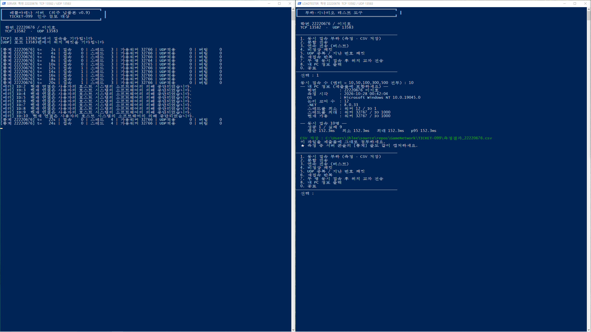

### C-3. 실행 증명 2: 의견 10

```
의견 10 을 실제로 해봤습니다
한 일 : 업체가 "부하 테스트는 불필요"하다고 한 원본 납품본에 LoadTester 1번을
        그대로 돌렸습니다 (10·50·100·300·500명, CSV 2026-10-27 23:48:58~23:49:48 행).
결과 : 10명은 10/0이었지만 50명 19/31, 100명 22/78, 300명 28/272, 500명 44/456 이었습니다.
        같은 시간 서버 통계는 접속 수와 스레드 수가 거의 같았고, 스레드가 12에서 63까지
        천천히 늘었습니다 (증거/logs/server_1027_233628.log).
        수신 부분(PacketHelper L51, L63)을 ReceiveAsync로 바꾸니 500명 중 499명이
        성공했습니다 (측정 ③). 업체의 "구조적으로 문제가 없다"는 판단은
        실제로 돌려 보면 맞지 않았습니다.
```
캡처: `증거/B1_before_load_결과_1027_235137.png` (Part A2), `증거/B1_before_load_진행_1027_235112.png` (Part B-2)

---

## Part D — 작업 과정

### D-1. git

- 저장소: https://github.com/Ulsan-Rock/GameNetwork (2주차에 만든 저장소)
- 브랜치: `midterm/ticket-099` (실험용 `exp/vendor-3`)
- 커밋은 단계마다 따로 했다. 순서는 원본 추가 → 학번 입력 → 도구·보고서 틀 → 원본 캡처 → 결함마다 수정 1개씩 → 측정마다 1개씩 → 실험 → 보고서이다 (2026-10-27 ~ 10-28). 메시지는 2주차 20쪽에서 배운 대로 "무엇을 왜 바꿨는지 알 수 있게" 썼다.
- 제출 시점의 커밋 개수, 커밋 시각, 푸시 상태는 `git.txt` 맨 위에 있다.
- `5ddb7e6` 와 그 아래 커밋("리드미 수정" 등)은 2~5주차 수업 때 만든 것이고, 이번 과제 커밋이 아니다.

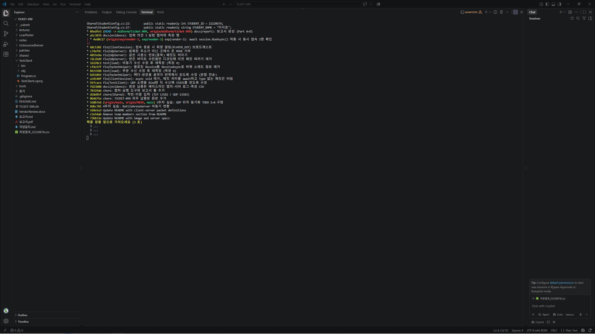

위 캡처는 GitHub에 푸시한 직후 찍었다. 로컬 브랜치 이름 옆에 `origin/midterm/ticket-099`, `origin/exp/vendor-3` 가 같이 붙어 있으면 GitHub에 올라간 상태다. 이 캡처를 보고서에 넣으면서 한 마지막 커밋들은 캡처보다 뒤에 생겨서 화면에는 없다. 그 커밋까지 포함한 전체 목록은 `git.txt` 에 있다.

### D-2. 막혔던 일

**막힘 1. "서버를 새로 띄웠는데" 사실은 옛 서버로 테스트하고 있었다**
```
처음 생각 : TestClient 확인이 끝나고 tools\start -Only Server 로 서버 창을 새로 띄웠으니,
            LT 2(분할 전송)는 당연히 새 서버로 갔다고 생각했다. 그래서 그대로 캡처했다.
확인 방법 : 찍은 캡처를 다시 보니 서버 창에 "[서버 종료] SocketException : 각 소켓 주소
            (프로토콜/네트워크 주소/포트)는 하나만 사용할 수 있습니다." 가 떠 있었다.
            그 시각의 서버 로그 두 개(server_1027_235619.log, server_1027_235324.log)를 비교했다.
결과 : 새 서버는 포트가 이미 쓰이고 있어서 시작도 못 했다. 앞 단계에서 띄운 서버 창이
       닫히지 않은 채 살아 있었고, LT 2는 그 옛 서버로 가서 옛 서버가
       JsonReaderException으로 죽었다. 결함은 나왔지만 캡처에는 죽는 화면이 없었다.
다음 생각 : 시나리오마다 작업표시줄에서 서버 창이 하나뿐인지 보고, 새 서버 창에
            "포트 13582번에서 접속을 기다립니다"가 뜬 것을 확인한 다음 LoadTester를
            돌렸다. 그렇게 A1 before를 다시 찍었다 (A1_before_split_1028_000140.png).
```

**막힘 2. SDK를 받았는데 dotnet이 없다고 나왔다**
```
처음 생각 : 실행 준비를 하는데 "dotnet 이 없습니다 (.NET 8 SDK 설치 필요)"가 떴다.
            .NET 다운로드 페이지에서 SDK 8.0.427 표의 Windows x64를 받아 압축을 풀었으니
            이제 설치된 줄 알았다.
확인 방법 : 받은 파일을 다시 봤더니 dotnet-sdk-8.0.427-win-x64.zip(약 285MB)이었고,
            푼 폴더는 다운로드 폴더 안에 그냥 있을 뿐 C:\Program Files 에 dotnet 폴더가 없었다.
결과 : 내가 누른 건 표의 "바이너리" 칸 x64(압축 파일)였고, "설치 관리자" 칸 x64(exe)가
       따로 있었다. 압축만 풀어서는 PATH에도 등록되지 않아 dotnet 명령이 없었다.
다음 생각 : 설치 관리자 dotnet-sdk-8.0.427-win-x64.exe 를 받아 설치했더니 dotnet 8.0.427 이
            잡혔고, 빌드가 경고 0 / 오류 0 으로 통과했다. 받기 전에 '설치 관리자'인지
            '바이너리'인지 칸을 먼저 확인해야 한다는 걸 알았다.
```

**그 밖에 헤맨 것 (짧게)**

- 원본으로 LT 1을 한 번 더 돌릴 때 서버를 다시 띄우지 않았더니 10명에서도 5/5가 나왔다 (CSV 23:50:41 행). 그 뒤로는 측정할 때마다 서버를 새로 띄웠다.
- A1 after를 찍을 때 서버 콘솔을 클릭했더니 창이 '선택' 모드가 돼서 통계 줄이 멈췄다. LoadTester 쪽에 응답이 두 개 다 돌아온 것으로 서버가 살아 있다는 걸 확인했다.
- 의견 3 실험 첫 시도에서 인원을 안 넣고 엔터를 눌러 전체 단계가 돌았다. 중간에 끄고 10명으로 다시 했다.
- git log 캡처를 찍으려고 log 명령과 캡처 명령을 같이 쳤더니, log 출력이 페이저에 걸려서 캡처가 실행되지 않았다. `git --no-pager log` 로 바꿨다. 다시 찍은 첫 캡처는 터미널이 작아서 이번 과제 커밋이 위로 밀려 안 보였고, 패널을 키워서 다시 찍었다.
- 푸시 명령 두 줄을 쳤는데 실험 브랜치만 올라가고 `midterm/ticket-099` 는 안 올라갔다. 캡처의 `origin/…` 표시를 보고 알았다. 인터넷이 끊겨 있었고, 복구된 뒤 다시 푸시하고 캡처도 다시 찍었다.

---

## 부록. 제출물 목록

| 파일 | 내용 |
|---|---|
| 보고서.pdf / 보고서.md | 이 문서 (Part A~D, Part C 판정표 포함) |
| 증거/ | 콘솔 캡처 23장, logs/ 서버 로그 18개 |
| 측정결과_22220676.csv | LoadTester가 만든 그대로 |
| 소스/ | 고친 솔루션 (bin/obj 제외). LoadTester는 손대지 않았다. 일부 파일은 git 체크아웃 과정에서 줄바꿈만 CRLF로 바뀌었고 내용은 커밋과 같다 |
| git.txt | 저장소 주소, 커밋 개수와 푸시 상태, git log --oneline --graph --all --decorate, 커밋 시각 |
